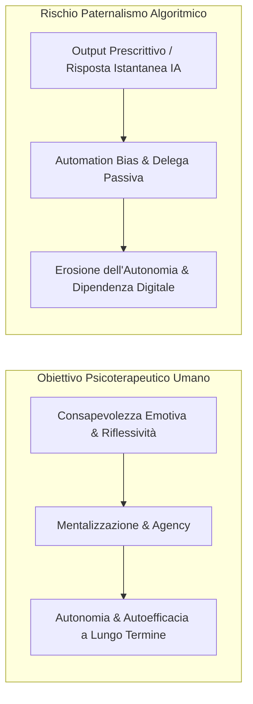

# Paternalismo Algoritmico e Autonomia del Paziente nell'IA Clinica

## Definizione Operativa

Il **paternalismo algoritmico (*algorithmic paternalism*)** in salute mentale descrive la dinamica per cui sistemi di intelligenza artificiale (chatbot psicoterapeutici, strumenti di monitoraggio predittivo, algoritmi di classificazione diagnostica) assumono un ruolo direttivo o prescrittivo sulle decisioni del paziente, riducendone la capacità di autodeterminazione, l'autoefficacia introspettiva e l'autonomia decisionale.

A differenza dell'alleanza terapeutica umana, orientata a promuovere l'autonomia del paziente e l'elaborazione dei conflitti, l'interazione con agenti di calcolo automatizzati può indurre una delega passiva e acritica verso l'output della macchina (*automation bias*).

## Evidenze dalla Letteratura

Nella revisione sistematica di Kandeel et al. (2026) e nella letteratura empirica correlata emergono pattern comportamentali critici:

1. **Affidamento alle Decisioni dell'Algoritmo**: Kandeel et al. (2026), citando Darcy et al. (2021), riportano che quasi il 25% dei pazienti si fida delle decisioni dell'IA più che di quelle dei clinici. Nello stesso articolo il dato compare anche in forma opposta (circa il 25% dei pazienti dichiara di non potersi fidare dell'IA per le decisioni), quindi va controllato sullo studio originale [da verificare].
2. **Erosione della Sicurezza Diagnostica dei Clinici**: una parte degli specializzandi in psichiatria riferisce una minore fiducia nelle proprie diagnosi (*reduced diagnostic confidence*) quando usa strumenti di IA (Kandeel et al., 2026, che citano Topol, 2019).
3. **Paternalismo Predittivo dai Wearable**: Notifiche biometriche predittive possono indurre profezie che si auto-avverano, portando il paziente a conformare i propri stati soggettivi all'indicatore della macchina [da verificare].

### Il Divario di Alfabetizzazione Sanitaria Digitale
Il rischio è amplificato dalle disuguaglianze socio-sanitarie (Kandeel et al., 2026):
- **Popolazione anziana e a basso reddito**: circa il 30% delle persone a basso reddito non possiede uno smartphone e le persone anziane aderiscono meno agli strumenti di IA per la salute mentale (Kandeel et al., 2026).
- **Spiegabilità poco accessibile**: il 40% dei pazienti in condizioni di povertà trova difficili le spiegazioni tecniche dei sistemi di IA (Dzangare & Gulu, 2025, citati in Kandeel et al., 2026).

### Paternalismo algoritmico nella formazione e nella supervisione
- Shafran et al. (2026) applicano il concetto alla formazione dei clinici. Quando un sistema molto autonomo viene trattato come se «sapesse meglio», le decisioni sul progresso dell'allievo o sulla sua supervisione possono essere prese senza il suo coinvolgimento: il paternalismo si sposta dal supervisore umano alla tecnologia.
- Formatori e supervisori che si rimettono alla tecnologia invece di esercitare il proprio giudizio rischiano di perdere gradualmente le proprie competenze, e le conclusioni di algoritmi complessi sono difficili da capire e da contestare (Shafran et al., 2026).
- Rimedi proposti: valutare di continuo l'utilità dello strumento, pretendere che l'IA spieghi le proprie decisioni, fondare la fiducia sul rispetto dell'autonomia umana e non sull'attribuzione alla macchina di intelligenza o intenzioni umane (Shafran et al., 2026). Vedi [[shafran-et-al-2026]] e [[supervisione-clinica-ai]].

## Riferimenti Bibliografici
*   Kandeel, M. E., Abo Hamza, E. G., Abouahmed, A., AbdelAziz, G. M., Hashish, A., Abo El Wafa, T., Khalil, A., & Eldakak, A. (2026). AI applications integrating legal and regulatory perspectives in mental health: Systematic review. *JMIR AI*, *5*, e84305. https://doi.org/10.2196/84305
*   Topol, E. J. (2019). *Deep medicine: How artificial intelligence can make healthcare human again*. Basic Books.
*   Darcy, A., Daniels, J., Salinger, D., Wicks, P., & Robinson, A. (2021). Evidence of human-level bonds established with a digital conversational agent: Cross-sectional, retrospective observational study. *JMIR Formative Research*, *5*(5), e27868. https://doi.org/10.2196/27868
*   Dzangare, G., & Gulu, T. A. (2025). Adopting artificial intelligence for health information literacy: A literature review. *Information Development*, *41*(3), 576–591. https://doi.org/10.1177/02666669251314839
*   Arya, V., Bellamy, R. K. E., Chen, P.-Y., et al. (2020). AI Explainability 360: An extensible toolkit for understanding data and machine learning models. *Journal of Machine Learning Research*, *21*, 1–6.
*   Torous, J., Bucci, S., Bell, I. H., et al. (2021). The growing field of digital psychiatry: Current evidence and the future of apps, social media, chatbots, and virtual reality. *World Psychiatry*, *20*(3), 318–335. https://doi.org/10.1002/wps.20883
*   Shafran, R., Bond, L., Carlbring, P., Cohen, Z. D., Creed, T. A., Davey, E., Egan, S. J., Freeman, D., Hollon, S. D., Jacobson, N. C., Johnson, C., Kaysen, D., McGuinness, D. L., Patel, V., Pozuelo, J. R., Santos, H., Singla, D. R., Wiltsey Stirman, S., Taylor, D. J., & Wade, T. D. (2026). From innovation to implementation: Artificial intelligence in cognitive behaviour therapy training and supervision. *Behaviour Research and Therapy*, *197*, Article 104945. https://doi.org/10.1016/j.brat.2025.104945

## Relazioni

- [[shafran-et-al-2026]]

- [[kandeel-et-al-2026]]
- [[gdpr-governance-mental-health-ai]]
- [[fast-food-psychotherapy]]
- [[sycophantic-mirroring]]
- [[calibrated-mismatches]]
- [[simulated-empathy-vs-authentic-presence]]
- [[human-in-the-reasoning]]
- [[cross-cultural-bias-and-fairness-audits-ai]]
- [[explainable-mental-health-diagnosis]]
