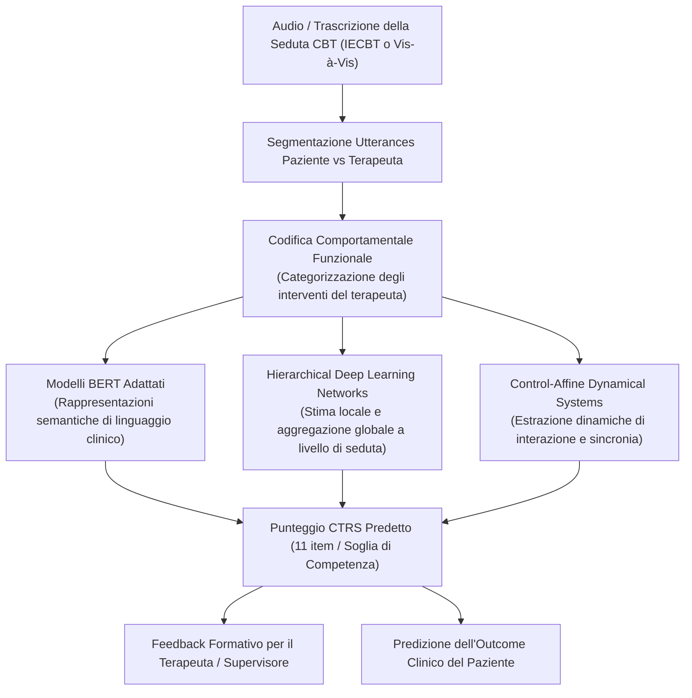

# Automated CTRS and Fidelity Evaluation (Valutazione Automatizzata della Fidelity e Qualità CBT)

## Definizione Operativa
L'impiego di modelli di Elaborazione del Linguaggio Naturale (NLP), rappresentazioni contestualizzate (BERT adattato) e architetture gerarchiche di Deep Learning per valutare in modo scalabile e oggettivo la competenza del terapeuta e la fedeltà al protocollo terapeutico (*treatment fidelity*) nelle sedute di Terapia Cognitivo-Comportamentale, quantificando i punteggi sulla scala standardizzata **Cognitive Therapy Rating Scale (CTRS)** (Jiang et al., 2024; Flemotomos et al., 2021; Chen et al., 2022b).

La scala CTRS definisce **11 dimensioni di competenza clinica** a livello di seduta (es. definizione dell'agenda, identificazione dei pensieri automatici, uso del dialogo socratico, compiti a casa, collaborazione e alleanza terapeutica).

---

## Architettura di Valutazione Automatizzata della Seduta

---

## Evidenze Empiriche e Validazione

### 1. Correlazione tra Fedeltà al Protocollo ed Esito Clinico
- In uno studio su vasta scala su oltre **14.000 pazienti** trattati con Internet-enabled CBT (IECBT), Ewbank et al. (2020) hanno addestrato modelli di deep learning per categorizzare ogni singolo enunciato del terapeuta.
- **Risultato Fondamentale:** Una maggiore percentuale di interventi coerenti con il protocollo CBT correlava positivamente e significativamente con il miglioramento sintomatico del paziente; al contrario, il tempo speso in conversazioni non focalizzate sulla terapia mostrava una correlazione negativa con l'esito.

### 2. Modelli Linguistici Adattati per la CTRS (Flemotomos et al., 2021, 2022)
- Impiego di modelli linguistici BERT pre-addestrati e fine-tunati su trascrizioni psicoterapeutiche reali per classificare il superamento della soglia di competenza CTRS (score binario e punteggi continui).
- L'analisi automatica del linguaggio verbale e prosodico ha permesso di quantificare competenze specifiche come l'empatia, il timing delle interpretazioni e la guida socratica con alta coerenza rispetto ai valutatori umani esperti.

### 3. Architetture Gerarchiche e Dinamiche Conversazionali (Chen et al., 2022b; Ardulov et al., 2022)
- Modelli gerarchici che combinano stime di qualità a livello di singolo scambio (*turn-level*) con metriche globali di seduta (*session-level*), preservando la struttura narrativa della conversazione.
- Analisi mediante sistemi dinamici affini al controllo (*control-affine models*) per tracciare i pattern di reciprocità e sintonizzazione verbale tra clinico e paziente.

### 4. Aderenza e competenza: i limiti del rating automatico (Shafran et al., 2026)
- Verificare l'**aderenza** al protocollo (fare ciò che prevede, senza elementi estranei) è possibile con checklist ed è adatto all'automazione. Valutare la **competenza** è più difficile, per l'IA come per gli umani, perché richiede un'applicazione flessibile delle tecniche e la concettualizzazione del caso (Shafran et al., 2026).
- Rischio di classificazione errata: con un paziente a rischio suicidario la scelta competente può essere *non* usare certe tecniche di cambiamento o privilegiare la collaborazione, ma un sistema basato solo sulla CTS-R la registrerebbe come carenza (Shafran et al., 2026).
- Secondo gli autori gli algoritmi raggiungono un'affidabilità equivalente a quella dei codificatori umani; i clinici giudicano questi strumenti accettabili e fattibili, ed è in corso un trial ibrido di implementazione ed efficacia in un grande sistema pubblico di salute mentale (Shafran et al., 2026).
- Raccomandazioni: usare gli indicatori osservabili di competenza dell'iniziativa WHO-UNICEF EQUIP, ricavare i benchmark di fedeltà da campioni rappresentativi delle popolazioni in cui lo strumento sarà usato, e rendere ispezionabili le misure con cui è stata etichettata la qualità nei dataset di addestramento (Shafran et al., 2026). Vedi [[shafran-et-al-2026]].

---

## Applicazioni nella Formazione e nella Supervisione Clinica
- **Supervisione Continua e Scalabile:** Superamento del collo di bottiglia della supervisione manuale (che richiede l'ascolto integrale di ore di registrazione da parte di supervisori esperti).
- **Cruscotto di Autovalutazione:** Restituzione al terapeuta di metriche quantitative sulle aree di eccellenza e sui punti deboli (es. insufficiente revisione dei compiti a casa, eccessiva direttività, dispersione dell'agenda).
- **Integrazione con Ambienti di Simulazione (PATIENT-Ψ):** Valutazione automatica istantanea delle competenze degli studenti durante simulazioni con pazienti virtuali LLM (Wang et al., 2024a).
- **Piattaforme commerciali:** il fornitore di una piattaforma clinica ha riferito al gruppo un progetto con Kazantzis e l'Università di Melbourne per confrontare i punteggi CTRS assegnati da una pipeline di IA con quelli dei supervisori. È una dichiarazione del fornitore, non un risultato pubblicato (cfr. [[10-16-riunione-demo-piattaforma-pilota]]).

---

## Relazioni
- [[clinical-fidelity-assessment]]: Concetto generale di fidelity e behavioral coding.
- [[ai-enhanced-cbt]]: Ruolo dell'IA nella valutazione del processo terapeutico.
- [[treatment-outcome-and-relapse-prediction]]: Impatto della qualità erogata sugli esiti a lungo termine.
- [[simulazione-pazienti-ai]]: Training e debriefing con pazienti virtuali.
- [[jiang-et-al-2024]]: Studio di review di riferimento.
- [[shafran-et-al-2026]]: Aderenza, competenza e linee guida per l'IA nella formazione CBT.

## Riferimenti Bibliografici
- Ardulov, V., Creed, T. A., Atkins, D. C., et al. (2022). Local dynamic mode of cognitive behavioral therapy. *arXiv preprint* arXiv:220509752.
- Chen, Z., Flemotomos, N., Singla, K., et al. (2022b). An automated quality evaluation framework of psychotherapy conversations with local quality estimates. *Computer Speech & Language*, *75*, 101380.
- Ewbank, M. P., Cummins, R., Tablan, V., et al. (2020). Quantifying the association between psychotherapy content and clinical outcomes using deep learning. *JAMA psychiatry*, *77*(1), 35–43.
- Flemotomos, N., Martinez, V. R., Chen, Z., et al. (2021). Automated quality assessment of cognitive behavioral therapy sessions through highly contextualized language representations. *PloS one*, *16*(10), e0258639.
- Jiang, M., Yu, Y. J., Zhao, Q., et al. (2024). Ai-enhanced cognitive behavioral therapy: Deep learning and large language models for extracting cognitive pathways from social media texts. *arXiv preprint* arXiv:240411449.
- Shafran, R., Bond, L., Carlbring, P., Cohen, Z. D., Creed, T. A., Davey, E., Egan, S. J., Freeman, D., Hollon, S. D., Jacobson, N. C., Johnson, C., Kaysen, D., McGuinness, D. L., Patel, V., Pozuelo, J. R., Santos, H., Singla, D. R., Wiltsey Stirman, S., Taylor, D. J., & Wade, T. D. (2026). From innovation to implementation: Artificial intelligence in cognitive behaviour therapy training and supervision. *Behaviour Research and Therapy*, *197*, Article 104945. https://doi.org/10.1016/j.brat.2025.104945
- Wang, R., Milani, S., Chiu, J. C., et al. (2024). PATIENT-Ψ: Using large language models to simulate patients for training mental health professionals. In *Proceedings of the 2024 Conference on Empirical Methods in Natural Language Processing*. Association for Computational Linguistics. https://doi.org/10.48550/arXiv.2405.19660
