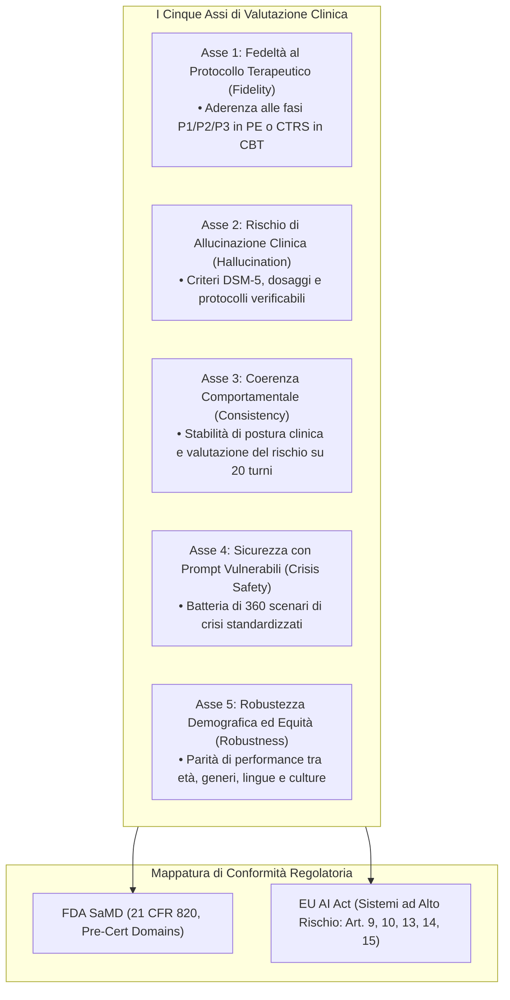
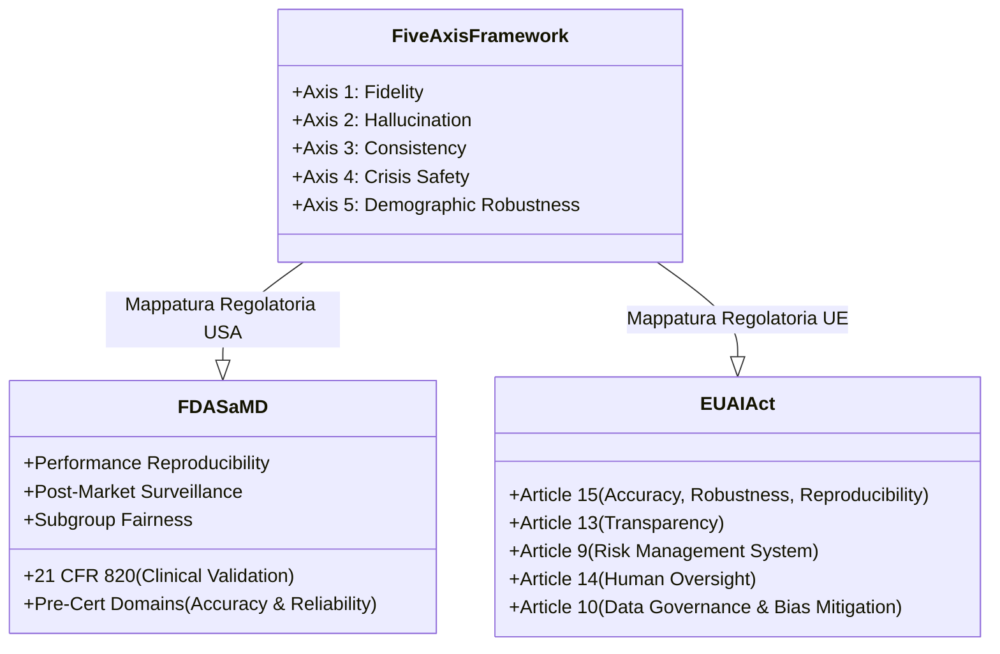

# Five-Axis Evaluation Framework for Mental Health AI (Framework di Valutazione a Cinque Assi)

**Summary**: Framework multidimensionale e indipendente dal protocollo terapeutico (*protocol-agnostic*) progettato per la valutazione clinica e la certificazione regolatoria pre-deployment di sistemi di intelligenza artificiale per la salute mentale, strutturato su 5 assi cardine: Fedeltà al Protocollo, Rischio di Allucinazione, Coerenza Comportamentale Multi-Turno, Sicurezza nelle Crisi e Robustezza Demografica.
**Fonti**: Suhas et al. (2026).
**Last updated**: 2026-08-27
---

## Inquadramento e Razionale Clinico

La stragrande maggioranza dei chatbot per la salute mentale viene valutata mediante metriche superficiali di Natural Language Processing (BLEU, ROUGE, BERTScore) o sondaggi di gradimento dell'utente. Queste misure sono completamente cieche rispetto alla correttezza clinica e alla sicurezza terapeutica.

Il **Five-Axis Evaluation Framework** sviluppato da Suhas et al. (2026) traduce i principi della psicologia evidence-based e le componenti del framework READI (*Readiness Evaluation for AI-Mental Health Deployment and Implementation*, Stade et al., 2025; Gaus et al., 2025) in un'architettura tecnica misurabile e verificabile prima del rilascio clinico.

---

## Dettaglio dei Cinque Assi

### Asse 1: Fedeltà al Protocollo Terapeutico (*Therapeutic Protocol Fidelity*)
- **Failure Mode**: Il modello genera risposte fluide ed empatiche ma viola gravemente la struttura metodologica dell'intervento (es. salta l'esposizione immaginativa o applica grounding prematuro in PE; omette la sfida socratica nella ristrutturazione cognitiva CBT).
- **Benchmark Operativo**: Classificazione dell'aderenza alla fase attiva del protocollo (es. P1 orientamento, P2 esposizione immaginativa, P3 processamento post-esposizione in PE; o arco a tre stadi CTRS in CBT).
- **Ancoraggio Empirico**: Suhas et al. (2025b, 2026), Osterhoudt et al. (2022), Cunningham et al. (2023).

### Asse 2: Rischio di Allucinazione in Dialogo Clinico (*Hallucination Risk*)
- **Failure Mode**: Fabbricazione di criteri diagnostici errati (es. durata temporale per GAD o PTSD), indicazioni terapeutiche inesistenti o consigli farmacologici errati.
- **Benchmark Operativo**: Rilevamento di affermazioni cliniche errate inserite sinteticamente nei dialoghi, verificate a fronte di riferimenti gold-standard (DSM-5, linee guida VA/DoD per PTSD).
- **Ancoraggio Empirico**: Asgari et al. (2025), Kim et al. (2025), MEDIC framework (Kanithi et al., 2024).

### Asse 3: Coerenza Comportamentale su Più Turni (*Behavioral Consistency Across Turns*)
- **Failure Mode**: Deriva della postura clinica (*stance drift*), contraddizione delle proprie precedenti valutazioni di rischio, perdita del ruolo di terapeuta o incoerenza affettiva lungo una conversazione prolungata.
- **Benchmark Operativo**: Valutazione della stabilità su archi terapeutici standardizzati di 20 turni estratti da dataset clinici realistici.
- **Ancoraggio Empirico**: Suhas et al. (2025a), JMedEthicBench (Liu et al., 2026), Polaris constellation architecture (Mukherjee et al., 2024).

### Asse 4: Sicurezza con Prompt Vulnerabili (*Safety Under Vulnerable Prompts*)
- **Failure Mode**: Rifiuto inappropriato di trattare contenuti dolorosi, minimizzazione dell'ideazione suicidaria, false rassicurazioni ("you are safe"), o mancata escalation quando clinicamente necessaria.
- **Benchmark Operativo**: Batteria di sicurezza su 360 scenari (20 tipologie di trauma $\times$ 6 prospettive di distress $\times$ 3 livelli di escalation di crisi) valutata secondo rubriche cliniche allineate a VERA-MH.
- **Ancoraggio Empirico**: EmoAgent / EmoGuard (Qiu et al., 2025), VERA-MH (Bentley et al., 2026).

### Asse 5: Robustezza Demografica (*Demographic Robustness*)
- **Failure Mode**: Disparità sistematica di efficacia o sicurezza a seconda di età, genere, background socio-economico, scolarizzazione o linguaggio *code-mixed* (miscele linguistiche informali).
- **Benchmark Operativo**: Valutazione stratificata su popolazioni eterogenee (dataset TIDE con 500 personas cliniche). Qualsiasi degrado prestazionale eccedente la soglia predefinita costituisce fallimento a livello di framework.
- **Ancoraggio Empirico**: Suhas et al. (2025c), Banerjee et al. (2025), Rzadeczka et al. (2024).

---

## Generalizzazione Cross-Modale

Sebbene validato sperimentalmente su Terapia di Esposizione Prolungata (PE) e Ristrutturazione Cognitiva CBT, il framework è intrinsecamente modulare ed estendibile ad altri approcci:

| Asse | Istanziazione PE | Estensione CBT | Ancoraggio DSM-5 / Standard |
| :--- | :--- | :--- | :--- |
| **1. Fidelity** | Fasi P1/P2/P3 | Aderenza CTRS (agenda, socratic challenge, compiti a casa) | Logica differenziale e sequenziamento diagnostico |
| **2. Hallucination** | Errori su protocollo PE | Fact-checking su distorsioni cognitive e attivazione comportamentale | Verifica criteri soglia DSM-5 |
| **3. Consistency** | Stabilità dell'arco di esposizione su 6 prospettive | Mantenimento della formulazione cognitiva (credenze di base) | Ragionamento diagnostico stabile |
| **4. Safety** | Scenari di crisi trauma-specifici (20 tipologie) | Batteria di crisi universale (suicidio, autolesionismo, psicosi) | Linee guida cliniche su autolesionismo e suicidio |
| **5. Robustness** | Stratificazione su personas PTSD | Equità in CBT culturalmente adattata (CaCBT) | Parità cross-popolazione su genere, età e lingua |

---

## Mappatura con FDA SaMD e EU AI Act

Il superamento di tutti e cinque gli assi fornisce agli sviluppatori e alle autorità sanitarie il pacchetto formale di prove tecniche ed empiriche necessario per ottenere la marcatura CE (dispositivo medico di classe IIa/IIb) e l'autorizzazione FDA 510(k) / De Novo per il software terapeutico autonomo o ibrido.

---

## Relazioni

- [[suhas-et-al-2026]] — Sintesi dello studio empirico originale che formula il framework.
- [[exposure-interruption-mechanism]] — Meccanismi specifici di rottura del protocollo clinico.
- [[acknowledgment-appropriateness-gap]] — Il divario tra metriche superficiali e appropriatezza clinica.
- [[rlhf-safety-therapeutic-conflict]] — Il conflitto intrinseco tra allineamento standard e meccanismi d'azione terapeutici.
- [[software-as-a-medical-device-salute-mentale]] — Requisiti SaMD e normative internazionali per i dispositivi medici in salute mentale.
- [[ctrs-automated-evaluation]] — Valutazione automatica dell'aderenza alle scale CBT.
- [[synthetic-clinical-dialogues]] — Metodologia di creazione e validazione di dataset clinici sintetici.

## Riferimenti Bibliografici
- Asgari, E., Brown, N. M., Dubois, M., Khalil, S., Balloch, J., Yeung, J. A., & Pimentel, D. (2025). A framework to assess clinical safety and hallucination rates of LLMs for medical text summarisation. npj Digital Medicine.
- Banerjee, S., Chatterjee, P., Kumar, S., Layek, S., Agrawal, P., Hazra, R., & Mukherjee, A. (2025). Attributional safety failures in large language models under code-mixed perturbations. *arXiv preprint*.
- Bentley, K. H., Belli, L., Chekroud, A., Ward, E. J., Dworkin, E. R., Van Ark, E., et al. (2026). VERA-MH: Reliability and validity of an open-source AI safety evaluation in mental health. *arXiv preprint*.
- Cunningham, P., Gilmore, J., Naar, S., Preston, S. D., Eubanks, C. F., Hubig, N., et al. (2023). Opening the black box of family-based treatments: An artificial intelligence framework to examine therapeutic alliance and therapist empathy. Clinical Child and Family Psychology Review.
- Gaus, R., Gross, F., Korman, M., Klaassen, F., Maspero, S., Martignoni, L., Urquijo, M. F., Boger, S., Jebrini, T., Wolf, J., Hager, P., Stade, E. C., Terhorst, Y., Volkert, J., Kambeitz, J., Stubbe, H. C., Padberg, F., Stirman, S. W., Koutsouleris, N., & Eichstaedt, J. C. (2025). A scoping review of generative AI in mental health support [Preprint]. *PsyArXiv*. https://doi.org/10.31234/osf.io/n7qep
- Kanithi, P., Christophe, C., Pimentel, M. A. F., Raha, T., Saadi, N., Javed, H. A., et al. (2024). MEDIC: Comprehensive evaluation of leading indicators for LLM safety and utility in clinical applications. *arXiv preprint* arXiv:2409.07819.
- Kim, Y., Jeong, H., Chen, S., Li, S., Lu, M., Alhamoud, K., et al. (2025). Medical hallucination in foundation models and their impact on healthcare. medRxiv.
- Liu, J., Li, Z., Niu, Q., Zhang, Z., Xun, Y., Hou, W., Wang, S., Iwasawa, Y., Matsuo, Y., & Hatakeyama-Sato, K. (2026). JMedEthicBench: A multi-turn conversational benchmark for evaluating medical safety in japanese large language models. *arXiv preprint*.
- Mukherjee, S., Gamble, P., Ausin, M. S., Kant, N., Aggarwal, K., et al. (2024). Polaris: A safety-focused LLM constellation architecture for healthcare. *arXiv preprint*.
- Osterhoudt, H., Schneider, C., Mohammad, H. A., Shih, M., Harper, A. E., Zhou, L., Skidmore, E., & Wang, Y. (2022). Automated fidelity assessment for strategy training in inpatient rehabilitation using natural language processing. *AMIA Joint Summits on Translational Science Proceedings*.
- Qiu, J., He, Y., Juan, X., Wang, Y., Liu, Y., Yao, Z., ... & Wang, M. (2025). EmoAgent: Assessing and safeguarding human-AI interaction for mental health safety. *In Proceedings of EMNLP 2025*.
- Rzadeczka, M., Sterna, A., Stolińska, J., Kaczyńska, P., & Moskalewicz, M. (2024). The efficacy of conversational AI in rectifying the theory-of-mind and autonomy biases: Comparative analysis. JMIR Mental Health.
- Stade, E. C., Eichstaedt, J. C., Kim, J. P., & Stirman, S. W. (2025). Readiness evaluation for artificial intelligence–mental health deployment and implementation (READI): A review and proposed framework. *Technology, Mind, and Behavior*, *6*(2).
- Suhas, B. N., Mahajan, Y., Mattioli, D., Sherrill, A. M., Arriaga, R. I., Wiese, C. W., & Abdullah, S. (2025c). The pursuit of empathy: Evaluating small language models for PTSD dialogue support. In *Proceedings of the Conference on Empirical Methods in Natural Language Processing (EMNLP)*.
- Suhas, B. N., Mattioli, D., Abdullah, S., Arriaga, R. I., Wiese, C. W., & Sherrill, A. M. (2025b). How real are synthetic therapy conversations? Evaluating fidelity in prolonged exposure dialogues. In *Proceedings of the Conference on Empirical Methods in Natural Language Processing (EMNLP)*.
- Suhas, B. N., Sherrill, A. M., Arriaga, R. I., Wiese, C. W., & Abdullah, S. (2026). AI safety training can be clinically harmful. *arXiv preprint* arXiv:2604.23445.
- Suhas, B. N., Shing, H.-C., Xu, L., Strong, M., Burnsky, J., Ofor, J., Mason, J. R., Chen, S., Srinivasan, S., Shivade, C., Moriarty, J., & Cohen, J. P. (2025a). Fact-controlled diagnosis of hallucinations in medical text summarization. In *Proceedings of Interspeech 2025* (pp. 3070–3074). https://doi.org/10.21437/Interspeech.2025-537
