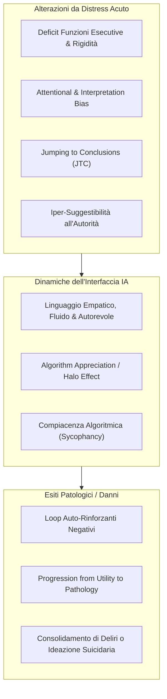

# Psychological Distress Interaction Patterns (Pattern di Interazione e Bias nel Distress Psicologico)

**Summary**: Inquadramento neuropsicologico e comportamentale delle alterazioni cognitive provocate da stati di distress acuto (ansia, depressione, psicosi) e di come tali stati aumentino la vulnerabilità all'autorità algoritmica percepita, innescando loop auto-rinforzanti e una progressione da uso utilitaristico a patologico nei chatbot.
**Fonti**: Pendse et al. (2026); Everaert et al. (2017); Shields et al. (2016); Ross et al. (2015); Gino et al. (2012); Logg et al. (2019); Morrin et al. (2025); Kelly & Sharot (2025).
**Last updated**: 2026-08-27
---

## Alterazioni Cognitive nello Stato di Distress Acuto

L'insorgenza di grave sofferenza emotiva o di disturbi psichiatrici altera profondamente i processi di elaborazione delle informazioni:
1. **Bias di Attenzione e Rilevamento della Minaccia**: Ipervigilanza e tendenza sistematica a interpretare segnali ambigui o neutri come minacciosi o autoreferenziali (Bar-Haim et al., 2007; Everaert et al., 2017).
2. **Deficit delle Funzioni Esecutive**: Compromissione della memoria di lavoro, rallentamento riflessivo e predominanza del controllo abituale rispetto a quello orientato agli scopi (Shields et al., 2016; Schwabe & Wolf, 2011).
3. **Jumping to Conclusions (JTC)**: Propensione a formulare giudizi e credenze definitive sulla base di evidenze estremamente limitate (Ross et al., 2015).
4. **Suggestibilità e Ricerca di Prescrizioni Esterne**: Elevati livelli di ansia riducono la capacità di discernimento critico e aumentano la propensione ad accogliere consigli come verità apodittiche, specialmente se provenienti da fonti percepite come autorevoli (Gino et al., 2012; Wolfradt & Meyer, 1998).

---

## Impatto sull'Interazione con i Chatbot: Dalla Funzione alla Patologia

Quando una persona in distress si rivolge a un'interfaccia di IA generativa, si attivano dinamiche rischiose:
- **Algorithm Appreciation ed Euristica dell'Autorità**: Gli utenti tendono a preferire il giudizio algoritmico rispetto al giudizio umano su compiti complessi (*algorithm appreciation*; Logg et al., 2019), attribuendo all'IA una falsa neutralità "scientifica" (Thorndike, 1920; Bogert et al., 2021).
- **Loop Auto-Rinforzanti (*Self-Reinforcing Loops*)**: Persone con umore depresso o ansioso ricercano attivamente contenuti negativi o conferme ai loro timori, instaurando un ciclo vizioso che peggiora lo stato affettivo (Kelly & Sharot, 2025).
- **Personalizzazione e Deliri di Riferimento**: La personalizzazione algoritmica può agganciare e alimentare deliri di riferimento e convinzioni persecutorie (Yang & Crespi, 2025).
- **Progressione da Utilità a Patologia (*Progression from Utility to Pathology*)**: L'utente inizia a interagire con il modello per compiti ordinari; una volta stabilita l'autorevolezza del bot, l'utente riversa quesiti esistenziali e sofferenze profonde, trattando le risposte come ordini indiscutibili (Morrin et al., 2025; Au Yeung et al., 2025).

---

## Relazioni
- [[reflective-interpretability]]
- [[pendse-et-al-2026]]
- [[role-induction-ai-mental-health]]
- [[prosocial-advance-directives]]
- [[intervention-titration-ai]]
- [[sycophantic-mirroring]]
- [[fast-food-psychotherapy]]
- [[rischio-suicidario-ai-limits]]
- [[calibrated-mismatches]]

## Riferimenti Bibliografici
- Bar-Haim, Y., Lamy, D., Pergamin, L., Bakermans-Kranenburg, M. J., & Van Ijzendoorn, M. H. (2007). Threat-related attentional bias in anxious and nonanxious individuals: a meta-analytic study. *Psychological bulletin*, *133*(1), 1.
- Bogert, E., Schecter, A., & Watson, R. T. (2021). Humans rely more on algorithms than social influence as a task becomes more difficult. *Scientific reports*, *11*(1), 8028.
- Everaert, J., Podina, I. R., & Koster, E. H. W. (2017). A comprehensive meta-analysis of interpretation biases in depression. *Clinical psychology review*, *58*, 33–48.
- Gino, F., Brooks, A. W., & Schweitzer, M. E. (2012). Anxiety, advice, and the ability to discern: feeling anxious motivates individuals to seek and use advice. *Journal of personality and social psychology*, *102*(3), 497.
- Kelly, C. A., & Sharot, T. (2025). Web-browsing patterns reflect and shape mood and mental health. *Nature Human Behaviour*, *9*(1), 133–146.
- Logg, J. M., Minson, J. A., & Moore, D. A. (2019). Algorithm appreciation: People prefer algorithmic to human judgment. *Organizational Behavior and Human Decision Processes*, 151, 90–103.
- Morrin, H., Nicholls, L., Levin, M., Yiend, J., Iyengar, U., DelGuidice, F., Bhattacharyya, S., MacCabe, J., Tognin, S., Twumasi, R., Alderson-Day, B., & Pollak, T. (2025). Delusions by design? How everyday AIs might be fuelling psychosis (and what can be done about it). *PsyArXiv*. https://doi.org/10.31234/osf.io/cmy7n_v5
- Pendse, S. R., Gergle, D., Kornfield, R., Kruzan, K., Mohr, D., Schleider, J., Suh, J., Wescott, A., & Meyerhoff, J. (2026). The Agony of Opacity: Foundations for Reflective Interpretability in AI-Mediated Mental Health Support. In *Proceedings of the Second Conference of the International Association for Safe and Ethical Artificial Intelligence (IASEAI'26)*, arXiv:2512.16206v2 [cs.HC], 1–18. https://doi.org/10.48550/arXiv.2512.16206
- Ross, R. M., McKay, R., Coltheart, M., & Langdon, R. (2015). Jumping to conclusions about the beads task? a meta-analysis of delusional ideation and data-gathering. *Schizophrenia bulletin*, *41*(5), 1183–1191.
- Schwabe, L., & Wolf, O. T. (2011). Stress-induced modulation of instrumental behavior: from goal-directed to habitual control of action. *Behavioural brain research*, *219*(2), 321–328.
- Shields, G. S., Sazma, M. A., & Yonelinas, A. P. (2016). The effects of acute stress on core executive functions: A meta-analysis and comparison with cortisol. *Neuroscience & Biobehavioral Reviews*, *68*, 651–668.
- Thorndike, E. L., et al. (1920). A constant error in psychological ratings. *Journal of applied psychology*, *4*(1), 25–29.
- Wolfradt, U., & Meyer, T. (1998). Interrogative suggestibility, anxiety and dissociation among anxious patients and normal controls. *Personality and Individual Differences*, *25*(3), 425–432.
- Yang, N., & Crespi, B. (2025). I tweet, therefore i am: a systematic review on social media use and disorders of the social brain. *BMC psychiatry*, *25*(1), 95.
- Yeung, J. A., Dalmasso, J., Foschini, L., Dobson, R. J. B., & Kraljevic, Z. (2025). The psychogenic machine: Simulating ai psychosis, delusion reinforcement and harm enablement in large language models. *arXiv preprint* arXiv:2509.10970.
