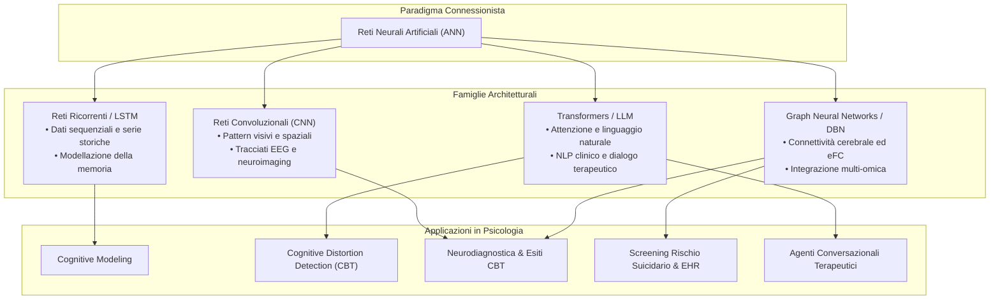

# Reti Neurali in Psicologia (Artificial Neural Networks in Psychology)

## Definizione Operativa
- Modelli computazionali non lineari e probabilistici appartenenti al paradigma connessionista dell'Intelligenza Artificiale, composti da strati di nodi interconnessi (pesi sinaptici) che apprendono rappresentazioni gerarchiche direttamente dai dati senza regole simboliche rigide predeterminate.
- **Utilità CBT / Applicativa:** Consentono di simulare processi cognitivi umani (memoria, apprendimento, decision-making), classificare automaticamente distorsioni cognitive da testi clinici, decodificare pattern neurobiologici (fMRI, EEG) per la predizione degli esiti terapeutici e alimentare chatbot conversazionali per interventi digitali di supporto.

---

## Architettura e Modelli Principali

---

## Evidenze dalla Letteratura

### 1. Modellazione Cognitiva (Cognitive Modeling)
- Rispetto ai sistemi simbolici e basati su regole esplicite come i modelli ACT-R e SOAR, le reti neurali artificiali forniscono un'approssimazione biologicamente e funzionalmente più plausibile dei processi mentali (Beg & Verma, 2023).
- L'adozione di architetture ricorrenti con celle di memoria come le *Long Short-Term Memory* (LSTM) consente di simulare dinamiche di memorizzazione, recupero di informazioni e decadimento dell'attenzione nel tempo, rispecchiando i vincoli della memoria di lavoro umana (Beg & Verma, 2023).

### 2. Rilevazione delle Distorsioni Cognitive e NLP Clinico
- Le architetture basate su Transformer e modelli pre-addestrati di dominio (es. *MentalBERT*, *ERNIE 3.0*) sono impiegate per estrarre e classificare automaticamente schemi di pensiero disfunzionali (come catastrofizzazione, pensiero dicotomico e personalizzazione) a partire da trascrizioni di colloqui clinici, post online e diari terapeutici (Jiang et al., 2024; Ding et al., 2022).
- L'elaborazione congiunta di canali multimodali (testo, parametri acustici della voce e mimica facciale) migliora l'accuratezza diagnostica cogliendo l'incongruenza tra contenuto semantico verbale ed espressione affettiva (Singh et al., 2023).

### 3. Neuroimaging Funzionale e Predizione degli Esiti Psicoterapeutici
- Reti neurali convoluzionali (CNN) e modelli di apprendimento automatico supervisionato estraggono biomarcatori oggettivi da risonanza magnetica funzionale (fMRI) ed elettroencefalografia (EEG) per differenziare disturbi affettivi, schizofrenia e disturbi di personalità (Abu-Mahfouz et al., 2026; Nokeri, 2022).
- Nel Disturbo Ossessivo-Compulsivo (OCD), modelli computazionali applicati ai correlati neurali del controllo inibitorio sono stati sperimentati per predire la probabilità di risposta favorevole alla psicoterapia cognitivo-comportamentale (Dzinalija et al., 2026).

### 4. Analisi Multimodale del Rischio Suicidario
- Deep Neural Networks integrano narrazioni cliniche non strutturate da cartelle elettroniche (EHR), feature acustiche della voce ed espressione genica/epigenetica ematica (microRNA, siti di metilazione CpG), discriminando pazienti depressi a rischio suicidario con elevate accuratezze diagnostiche preliminari (Wang & Dwivedi, 2025; Bhak et al., 2019).

### 5. Interventi Digitali e Terapie Basate su Agenti Conversazionali
- Modelli linguistici generativi basati su reti neurali alimentano chatbot CBT (es. Woebot, Wysa, Youper), evidenziando un effect size moderato-grande nella riduzione dei sintomi depressivi a breve termine (Hedges' $g = 0.61$), pur mostrando un significativo decadimento di efficacia su ansia e stress dopo 8–12 settimane (Li et al., 2023; Abu-Mahfouz et al., 2026).

---

## Limiti Tecnici, Bias e Rischi Specifici Documentati

- **Performance Decay e Divario di Validazione Esterna:** La letteratura evidenzia una netta dicotomia tra validazione interna ed esterna. Su campioni monocentrici le reti neurali registrano picchi di accuratezza fino al 97% e AUC di 0.98–0.99 (es. CNN applicate a tracciati EEG), ma le prestazioni crollano (es. AUC a 0.73) quando testate su coorti cliniche esterne indipendenti a causa di overfitting (Abu-Mahfouz et al., 2026; Baydili et al., 2025).
- **Opacità Algoritmica (Black-Box Effect):** L'imperscrutabilità dei pesi sinaptici e dei passaggi intermedi impedisce la piena tracciabilità del ragionamento clinico, rendendo necessaria l'adozione di tecniche di *Explainable AI* (XAI) per l'uso decisionale sicuro (Beg & Verma, 2023; Xie et al., 2026).
- **Assenza di Intenzionalità Semantica e Rischio Allucinazioni:** Le reti generano testo o stime ottimizzando la plausibilità statistica locale, ma sono prive di reale comprensione semantica, empatia autentica o vincolo deontologico, con conseguente rischio di generare consigli non validati o mancare segnali critici di crisi acuta (Adamkovič, 2025; Hua et al., 2025).
- **Vulnerabilità ai Bias dei Dati:** Gli algoritmi rischiano di riflettere e cristallizzare disuguaglianze demografiche, di genere o culturali incorporate nei dataset di addestramento clinico (Beg & Verma, 2023; Tang et al., 2024).

---

## Riferimenti Bibliografici

- Abu-Mahfouz, M. S., AlFehaid, S., Burqan, H. M., & El Arab, R. A. (2026). Artificial intelligence in mental health care: A scoping review of reviews. *Frontiers in Psychiatry*, 17, 1688043. https://doi.org/10.3389/fpsyt.2026.1688043
- Adamkovič, M. (2025). *Large Language Models in (Not Only) Psychology Training and Research: A Brief Introduction*. Centre of Social and Psychological Sciences, Slovak Academy of Sciences. https://doi.org/10.31577/2025.9788082980144
- Beg, M. J., & Verma, M. K. (2023). *The Mind and Machine: An Introduction to Artificial Intelligence*. Amazon International. ISBN: 978-8374274424.
- Bhak, Y., et al. (2019). Resolving whole-genome epigenetic and transcriptional signatures of depression and suicide attempts. *Scientific Reports*, 9, 1515.
- Dzinalija, N., et al. (2026). Predicting cognitive-behavioral therapy outcomes in obsessive-compulsive disorder from inhibitory control neural activity: A mega-analysis and machine learning study from the ENIGMA-OCD consortium. *Biological Psychiatry: Cognitive Neuroscience and Neuroimaging*.
- Hua, J., et al. (2025). The technological evolution of conversational agents in psychiatry: A scoping review. *World Psychiatry*, 24(3), 383–394. https://doi.org/10.1002/wps.21352
- Jiang, Z., et al. (2024). Cognitive distortion detection in mental health texts: A comprehensive survey and benchmark. *arXiv preprint arXiv:2407.19422*.
- Nokeri, T. C. (2022). *Artificial Intelligence in Medical Sciences and Psychology: With Application of Machine Language, Computer Vision, and NLP Techniques*. Apress. https://doi.org/10.1007/978-1-4842-8217-5
- Wang, Q., & Dwivedi, Y. (2025). Recent developments in omics studies and artificial intelligence in depression and suicide. *Translational Psychiatry*, 15(1), 1–18. https://doi.org/10.1038/s41398-025-03497-6

---

## Relazioni
- Vedi anche: [[mind-and-machine-beg-verma-2023]], [[ai-medical-sciences-psychology-nokeri-2022]], [[fpsyt-17-1688043-1]], [[cognitive-distortion-detection]], [[large-language-models]], [[marketing-architecture-mismatch-in-mental-health-ai]], [[dzinalija-et-al-2026]], [[41398-2025-article-3497]]
