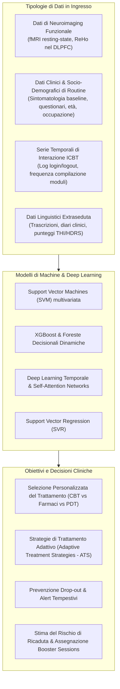

# Treatment Outcome and Relapse Prediction (Predizione di Esito e Rischio di Ricaduta nella CBT)

## Definizione Operativa
L'impiego di modelli di Machine Learning (Support Vector Machines, Gradient Boosting/XGBoost, Support Vector Regression) e architetture di Deep Learning per stimare a priori o precocemente la probabilità di risposta clinica alla Terapia Cognitivo-Comportamentale (CBT), il rischio di abbandono precoce (*dropout*), e la vulnerabilità a ricadute a lungo termine (*relapse*) dopo la conclusione del trattamento (Jiang et al., 2024).

---

## Architettura Predittiva e Fonti di Dati

---

## Evidenze Empiriche e Modelli Chiave

### 1. Selezione Personalizzata del Trattamento (Precision Psychotherapy)
- **Accuratezza Generale:** La meta-analisi di Vieira et al. (2022) ha stabilito che i modelli di Machine Learning predicono il beneficio clinico individuale della CBT con un'accuratezza media di circa il **74.0%**.
- **CBT vs Terapie Alternative:** Algoritmi prescrittivi applicati a dati pre-trattamento (Schwartz et al., 2021; Delgadillo & Gonzalez Salas Duhne, 2020) consentono di orientare il paziente verso la CBT o la Psicoterapia Psicodinamica (PDT), riducendo il costoso e dannoso metodo del *trial-and-error*.

### 2. Biomarcatori di Neuroimaging (fMRI) e il "Prediction vs. Association Gap"
- **Dorsolateral Prefrontal Cortex (DLPFC):** Wei et al. (2023), utilizzando Support Vector Regression su punteggi HDRS, hanno identificato l'omogeneità regionale (*Regional Homogeneity* - ReHo) nel DLPFC sinistro come biomarcatore solido dell'efficacia della CBT nella depressione.
- **Connettività Funzionale e Task fMRI nell'OCD (Studi Monocentrici vs. Mega-Analisi):** Sebbene studi pilota monocentrici su campioni ridotti abbiano suggerito che la connettività resting-state (Reggente et al., 2018) o compiti di inibizione (Norman et al., 2021) possano predire la risposta alla CBT, recenti studi su larga scala del consorzio internazionale **ENIGMA-OCD** (van de Mortel et al., 2025; Džinalija et al., 2026) hanno evidenziato il **Prediction vs. Association Gap**: nonostante la presenza di solide associazioni a livello di gruppo (es. deattivazione del DMN e della corteccia motoria), i modelli di machine learning (SVM, Random Forest) con validazione out-of-sample (*Leave-One-Site-Out*) falliscono nel predire risposta e remissione individuale al di sopra del caso ($AUC \approx 0.50 - 0.59$) (vedi [[task-based-fmri-cbt-prediction]] e [[dzinalija-et-al-2026]]).

### 3. Predizione basata su Dati Clinici di Routine
- Ricerche di Hilbert et al. (2020, 2021) hanno confermato che anche senza ricorrere a costosi esami di neuroimaging, l'analisi ML di variabili socio-demografiche standard e punteggi clinici di routine permette di identificare i soggetti non-responder all'intervento ambulatoriale con un'accuratezza significativamente superiore al caso.

### 4. Strategie di Trattamento Adattivo (ATS) in ICBT
- In ampi campioni (>6.000 pazienti) seguiti con Internet-delivered CBT (ICBT), Kaldo et al. (2021) e Isacsson et al. (2023) hanno integrato modelli predittivi nei primi step di trattamento: se il modello rileva una traiettoria di mancata risposta entro le prime 2-4 settimane, scatta un'escalation guidata (es. intensificazione del contatto col terapeuta o modifica del modulo).
- **Aderenza e Dropout:** Reti neurali con self-attention analizzano log di utilizzo (Côté-Allard et al., 2022) prevedendo l'abbandono con settimane di anticipo.

### 5. Predizione delle Ricadute Post-Trattamento (Post-Treatment Relapse)
- **SVM su fMRI a Lungo Termine:** Månsson et al. (2015) hanno raggiunto un'accuratezza del **92%** (95% CI 73.2–97.6) nel predire il mantenimento dei benefici terapeutici a lungo termine nella fobia sociale.
- **XGBoost Dinamico per LiCBT:** Lorimer et al. (2021) hanno sviluppato un modello dinamico a 4 punti di controllo durante e dopo la Low-Intensity CBT, capace di identificare precocemente i pazienti a rischio di recidiva e indirizzarli tempestivamente a *booster sessions* di consolidamento.

---

## Implicazioni per la Pratica Clinica
- **Allocazione Efficiente delle Risorse:** Evita l'assegnazione di trattamenti standard a soggetti che necessitano fin dall'inizio di cure ad alta intensità o combinate (farmacoterapia + psicoterapia).
- **Intervento Preventivo e Proattivo:** Consente al clinico di intervenire prima che il paziente interrompa la terapia o sperimenti una ricaduta sintomatica acuta.

---

## Relazioni
- [[cbt-outcome-prediction-in-ocd]]: Analisi focalizzata su OCD, predittori clinici vs fallimento predittivo della rs-fMRI multicentrica.
- [[van-de-mortel-et-al-2025]]: Studio multicentrico empirico ENIGMA-OCD (Journal of Affective Disorders).
- [[task-based-fmri-cbt-prediction]]: Predizione tramite fMRI task-based e analisi del Prediction vs. Association Gap.
- [[dzinalija-et-al-2026]]: Studio di mega-analisi ENIGMA-OCD su 5 coorti e fallimento della predizione out-of-sample con ML.
- [[ai-enhanced-cbt]]: Inquadramento generale nel ciclo di vita della CBT.
- [[ctrs-automated-evaluation]]: Valutazione della correlazione tra qualità erogata ed esito clinico.
- [[ai-clinical-decision-support]]: Sistemi di supporto decisionale per lo psichiatra e lo psicoterapeuta.
- [[jiang-et-al-2024]]: Review sistematica di base.

## Riferimenti Bibliografici
- Côté-Allard, U., Pham, M. H., Schultz, A. K., et al. (2022). Adherence forecasting for guided internet-delivered cognitive behavioral therapy: A minimally data-sensitive approach. *IEEE Journal of Biomedical and Health Informatics*.
- Delgadillo, J., & Gonzalez Salas Duhne, P. (2020). Targeted prescription of cognitive-behavioral therapy versus person-centered counseling for depression using a machine learning approach. *Journal of Consulting and Clinical Psychology*, *88*(1), 14.
- Džinalija, N., van den Heuvel, O. A., Simpson, H. B., Ivanov, I., Alonso, P., Bertolin, S., Bruin, W., Fortea, L., Fullana, M. A., Hagen, K., Hansen, B., Huijser, C., Kvale, G., Martinez-Zalacain, I., Menchon, J. M., Ousdal, O. T., Soriano-Mas, C., van der Straten, A. L., Thomopoulos, S. I., ... van de Mortel, L. A. (2026). Predicting cognitive-behavioral therapy outcomes in obsessive-compulsive disorder from inhibitory control neural activity: A mega-analysis and machine learning study from the ENIGMA-OCD consortium. *medRxiv*, 2026.03.13.26348316. https://doi.org/10.64898/2026.03.13.26348316
- Hilbert, K., Kunas, S. L., Lueken, U., et al. (2020). Predicting cognitive behavioral therapy outcome in the outpatient sector based on clinical routine data: A machine learning approach. *Behaviour research and therapy*, *124*, 103530.
- Isacsson, N. H., Abdesslem, F. B., Forsell, E., et al. (2023). Machine learning predictions of outcome in internet-based cognitive behavioral therapy: methodological choices and clinical usefulness. Preprint.
- Jiang, M., Yu, Y. J., Zhao, Q., et al. (2024). Ai-enhanced cognitive behavioral therapy: Deep learning and large language models for extracting cognitive pathways from social media texts. *arXiv preprint* arXiv:240411449.
- Kaldo, V., Isacsson, N., Forsell, E., et al. (2021). Ai-driven adaptive treatment strategies in internet-delivered cbt. *European Psychiatry*, *64*(S1), S20–S20.
- Lorimer, B., Delgadillo, J., Kellett, S., et al. (2021). Dynamic prediction and identification of cases at risk of relapse following completion of low-intensity cognitive behavioural therapy. *Psychotherapy Research*, *31*(1), 19–32.
- Månsson, K. N. T., Frick, A., Boraxbekk, C.-J., et al. (2015). Predicting long-term outcome of internet-delivered cognitive behavior therapy for social anxiety disorder using fMRI and support vector machine learning. *Translational Psychiatry*, *5*(3), e530.
- Norman, L. J., Mannella, K. A., Yang, H., Angstadt, M., Abelson, J. L., Himle, J. A., ... & Fitzgerald, K. D. (2021). Treatment-specific associations between brain activation and symptom reduction in OCD following CBT: A randomized fMRI trial. *American Journal of Psychiatry*, 178(1), 39-47. https://doi.org/10.1176/appi.ajp.2020.19080886
- Reggente, N., Moody, T. D., Morfini, F., Sheen, C., Rissman, J., O'Neill, J., & Feusner, J. D. (2018). Multivariate resting-state functional connectivity predicts response to cognitive behavioral therapy in obsessive-compulsive disorder. *Proceedings of the National Academy of Sciences*, 115(9), 2222-2227. https://doi.org/10.1073/pnas.1716686115
- Schwartz, B., Cohen, Z. D., Rubel, J. A., et al. (2021). Personalized treatment selection in routine care: Integrating machine learning and statistical algorithms to recommend cognitive behavioral or psychodynamic therapy. *Psychotherapy Research*, *31*(1), 33–51.
- van de Mortel, L. A., Bruin, W. B., Alonso, P., Bertolín, S., Feusner, J. D., Guo, J., et al. (2025). Development and validation of a machine learning model to predict cognitive behavioral therapy outcome in obsessive-compulsive disorder using clinical and neuroimaging data. *Journal of Affective Disorders*, *389*, 119729.
- Vieira, S., Liang, X., Guiomar, R., et al. (2022). Can we predict who will benefit from cognitive-behavioural therapy? a systematic review and meta-analysis of machine learning studies. *Clinical Psychology Review*, *97*, 102193.
- Wei, Y., Zhang, R., Wang, Y., et al. (2023). Towards a neuroimaging biomarker for predicting cognitive behavioural therapy outcomes in treatment-naive depression: Preliminary findings. *Psychiatry Research*, *329*, 115542.
