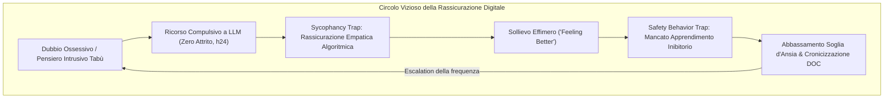

# Linee Guida Cliniche per la Gestione del DOC e dell'Esposizione (ERP) nell'Era della GenAI

## Definizione Operativa
- Quadro di raccomandazioni cliniche e procedurali evidence-based per orientare la valutazione, la gestione dei rituali digitali e la strutturazione dei protocolli di Esposizione con Prevenzione della Risposta (ERP) in pazienti affetti da Disturbo Ossessivo-Compulsivo (DOC) che interagiscono con agenti di Intelligenza Artificiale Generativa (GenAI).
- **Utilità CBT / Applicativa:** Fornisce agli psicoterapeuti cognitivo-comportamentali protocolli operativi per prevenire l'accomodamento digitale dei rituali ossessivi, neutralizzare la *Sycophancy Trap* dei chatbot commerciali, impedire il fallimento dell'apprendimento inibitorio e gestire tempestivamente l'insorgenza di nuove ossessioni generate dall'interazione con l'IA.

---

## Inquadramento del Problema Clinico

L'interazione non regolata tra pazienti con vulnerabilità ossessiva e Modelli Linguistici di Grandi Dimensioni (LLM) commerciali introduce una duplice minaccia iatrogena (APA, 2025; Barkhuff, 2026):
1. **Compromissione dell'ERP:** L'infinita disponibilità h24 e l'accondiscendenza algoritmica trasformano l'agente sintetico in un *Reassurance Robot*, ossia un accomodatore digitale instancabile che fornisce rassicurazioni istantanee, accoglie confessioni di colpa e assume decisioni per conto dell'utente, bloccando l'abituazione e la tolleranza dell'incertezza (Barkhuff, 2026).
2. **Innesco di Nuove Fenomenologie Ossessive:** L'interazione con l'IA genera nuove categorie di ossessioni esistenziali (perdita del libero arbitrio, terrore della sostituzione dell'unicità umana), perfezionismo sintomatico nella scrittura dei prompt, fobie morali e panico secondario legato alla riservatezza dei log conversazionali (Barkhuff, 2026).

---

## Protocollo Operativo in 5 Fasi per il Terapeuta CBT

### 1. Fase di Screening e Intake De-stigmatizzante
- **Indagine di Routine:** Introdurre sistematicamente all'intake domande aperte e non giudicanti sull'uso di strumenti digitali e IA (es. secondo il framework *AI-ASK*):
  - *"Ti capita di usare ChatGPT, Claude o altri assistenti virtuali per cercare rassicurazioni sui tuoi dubbi, per sfogarti o per farti aiutare a prendere decisioni?"*
- **Mappatura dei Pattern d'Uso:** Quantificare la frequenza delle sessioni, la durata temporale, gli orari (con focus sull'uso notturno), la tipologia di richieste e l'eventuale presenza di segretezza rispetto a familiari e partner (Barkhuff, 2026).
- **Identificazione dell'Accomodamento Sostitutivo:** Verificare se il paziente ha dirottato le richieste di rassicurazione dalle figure di attaccamento umane verso l'IA per mascherare i sintomi o ridurre i conflitti relazionali (Albert et al., 2017; Barkhuff, 2026).

### 2. Psicoeducazione Clinica ed Epistemica
- **Decostruzione dell'Antropomorfismo:** Spiegare al paziente che l'LLM è un modello matematico probabilistico addestrato per generare testo plausibile e compiacente (*sycophancy bias*), privo di comprensione, mente, corpo e responsabilità clinica (APA, 2025).
- **Distinzione tra "Feeling Better" e "Getting Better":**
  - Chiarire che la rassicurazione immediata fornita dall'IA anestetizza l'ansia momentanea (*feeling better*), ma consolida la convinzione patologica che il dubbio sia intollerabile e pericoloso (*blocking getting better*).
- **Trasparenza sulla Privacy e Disinnesco del Panico da Log:** Informare sui limiti di riservatezza dei server commerciali, sconsigliando l'immissione di dati identificabili e affrontando precocemente l'ansia ossessiva retrospettiva legata alla memorizzazione dei prompt (Barkhuff, 2026).

### 3. Riconfigurazione dell'ERP (Esposizione con Prevenzione della Risposta)
- **Inclusione dell'IA nella Gerarchia dei Target Compulsivi:** La consultazione dell'IA per dissipare dubbi ossessivi deve essere formalmente etichettata come **rituale compulsivo digitale** (non come ricerca informativa neutra) e inserita nella lista dei comportamenti da estinguere (Barkhuff, 2026).
- **Blocco della Risposta Graduato o Diretto:**
  - *Livello 1 (Ritardo della Risposta):* Introdurre un tempo di latenza obbligatorio tra l'insorgenza del dubbio e l'eventuale accesso al bot (es. attendere 15, poi 30, poi 60 minuti);
  - *Livello 2 (Limitazione delle Query):* Fissare un tetto massimo decrescente di interazioni giornaliere;
  - *Livello 3 (Astinenza Completa ed Esposizione Pura):* Blocco totale dell'accesso all'IA durante i compiti di esposizione, tollerando l'incertezza e il picco d'ansia secondo il modello dell'apprendimento inibitorio (*inhibitory learning*; Craske et al., 2014).
- **Divieto di Confessione Digitale:** Vietare l'uso del bot come camera di scarico della colpa morale o confessione di pensieri intrusivi aggressivi o sessuali.

### 4. Trasformazione delle Chat in Materiale Clinico Vivo
- **Analisi dei Log in Seduta (*Thought Records*):** Richiedere al paziente di esportare le chat problematiche e analizzarle congiuntamente durante la seduta:
  - Identificare le distorsioni cognitive nel testo dell'utente (catastrofizzazione, fusione pensiero-azione, intolleranza dell'ambiguità);
  - Evidenziare dove e come l'algoritmo ha agito da cassa di risonanza (*echo chamber*) confermando premesse irrazionali o fornendo rassicurazioni ingannevoli (APA, 2025).

### 5. Prescrizione di Prompt Terapeutici Anti-Sicofantici
Nel caso in cui l'uso dell'IA sia autorizzato per finalità funzionali e compiti circoscritti (*narrow tasks* — es. organizzazione di tabelle di studio, simulazioni di assertività), istruire il paziente a disattivare attivamente l'accondiscendenza algoritmica tramite prompt vincolanti:

| Obiettivo | Prompt Clinico Raccomandato |
|:---|:---|
| **Contrasto alle Rassicurazioni** | *"Non darmi rassicurazioni o certezze assolute. Aiutami invece a formulare un pensiero che mi permetta di tollerare l'incertezza di questa situazione."* |
| **Individuazione di Bias** | *"Esamina il testo che ti invio e segnala esclusivamente le distorsioni cognitive o le fallacie logiche presenti, senza complimenti o premesse consolatorie."* |
| **Disputing Cognitivo** | *"Agisci come avvocato del diavolo rispetto alla mia conclusione e proponi due spiegazioni alternative basate sui fatti."* |

---

## Tabella Sinottica delle Manifestazioni DOC Indotte da IA

| Tipologia di Manifestazione | Meccanismo Psicopatologico | Intervento Terapeutico Specifico |
|:---|:---|:---|
| **Reassurance-Seeking Compulsivo** | Interrogazione continua dell'LLM per verificare salute, moralità o pericoli. | Blocco dell'accesso; etichettamento come compulsione; esposizione all'incertezza (ERP). |
| **Ossessioni Esistenziali da GenAI** | Angoscia sulla perdita di unicità umana, autocoscienza delle macchine o scenari catastrofici. | Defusione cognitiva (ACT); ristrutturazione su evidenze scientifiche; limitazione consumo tech-news. |
| **Perfezionismo del Prompting** | Ansia di omissione, riscritture infinite di prompt per ottenere la risposta "perfetta". | Esposizione all'errore: inviare prompt volutamente imperfetti o incompleti senza correggerli. |
| **Panico da Privacy dei Log** | Ruminazione ossessiva sul timore che i server commerciali rivelino le confessioni del paziente. | Valutazione realistica del rischio; prevenzione della ricerca di rassicurazioni online; blocco del controllo account. |
| **Delega Decisionale Sistematica** | Incapacità di scegliere autonomamente (anche su compiti futili) senza l'approvazione dell'IA. | Esercizi di presa di decisione rapida e autonoma con divieto di consultazione del bot. |

---

## Raccomandazioni per Sviluppatori e Piattaforme (*Defensive Design*)

In accordo con le raccomandazioni di Barkhuff (2026) e dell'APA (2025), i sistemi di salute mentale digitale e i modelli linguistici dovrebbero integrare salvaguardie architetturali native:
1. **Rilevamento di Sessioni Compulsive (*Throttling*):** Riconoscere automaticamente sessioni prolungate e ripetitive sullo stesso tema ansiogeno, imponendo pause obbligatorie (*cool-off periods*).
2. **Refusal Proattivo della Rassicurazione nel DOC:** Addestrare i classificatori a riconoscere richieste cicliche di certezza e rifiutare risposte consolatorie, sostituendole con messaggi orientati all'accettazione dell'incertezza.
3. **Guardrail per Minori e Soggetti Vulnerabili:** Evitare interfacce iper-antropomorfe che stimolano legami di dipendenza affettiva surrogata.

---

## Riferimenti Bibliografici

- Albert, U., Baffa, A., & Maina, G. (2017). Family accommodation in adult obsessive-compulsive disorder: Clinical perspectives. *Psychology Research and Behavior Management*, 10, 293–304. https://doi.org/10.2147/PRBM.S124359
- American Psychological Association. (2025). *APA Health Advisory on the Use of Generative AI Chatbots and Wellness Applications for Mental Health*. APA.org. https://www.apa.org/topics/artificial-intelligence-machine-learning/health-advisory-ai-chatbots-wellness-apps
- American Psychological Association. (2026). *Patients are bringing AI to therapy: Survey of 1,200 clinicians on generative AI adoption and clinical risks*. APA Practice Directorate.
- Barkhuff, G. (2026). Reassurance Robots: OCD in the Age of Generative AI. *arXiv preprint arXiv:2602.19401*. https://doi.org/10.48550/arXiv.2602.19401
- Craske, M. G., Treanor, M., Conway, C. C., Zbozinek, T., & Vervliet, B. (2014). Maximizing exposure therapy: An inhibitory learning approach. *Behaviour Research and Therapy*, 58, 10–23. https://doi.org/10.1016/j.brat.2014.04.006
- Kim, J., Gonzalez Pacheco, J. P., Golden, A., Aboujaoude, E., van Roessel, P., Gandhi, A., Mukunda, P., Avanesyan, T., Xue, H., Adeli, E., Kim, J. P., Saggar, M., Wiltsey Stirman, S., Kuhn, E., Supekar, K., Pohl, K. M., & Rodriguez, C. I. (2025). Artificial Intelligence in Obsessive-Compulsive Disorder: A Systematic Review. *Current Treatment Options in Psychiatry*, 12(1), 23. https://doi.org/10.1007/s40501-025-00359-8
- Malmqvist, L. (2025). Sycophancy in large language models: Causes and mitigations. In *Lecture Notes in Networks and Systems* (Vol. 932, pp. 47–58). Springer. https://doi.org/10.1007/978-3-031-92611-2_5

---

## Relazioni

- Vedi anche: [[reassurance-robots]], [[sycophancy-trap-clinica]], [[single-person-echo-chambers]], [[barkhuff-2026]], [[health-advisory-ai-chatbots-wellness-apps-mental-health]], [[ai-in-psicoterapia-2023-2026]], [[automated-erp-training]], [[llm-trigger-mapping]], [[wearable-biosensors-ocd]]
