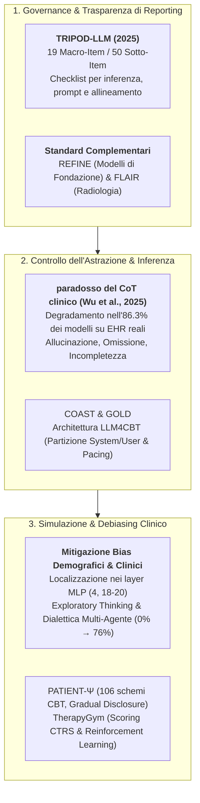
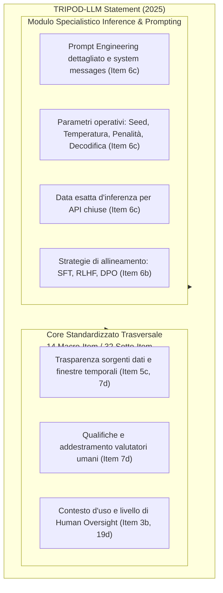
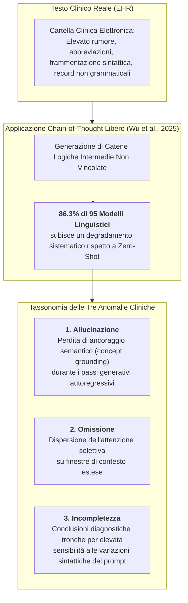
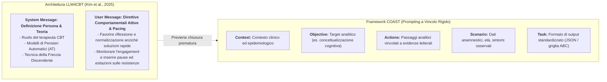
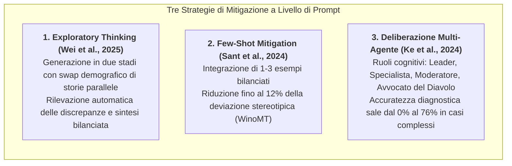
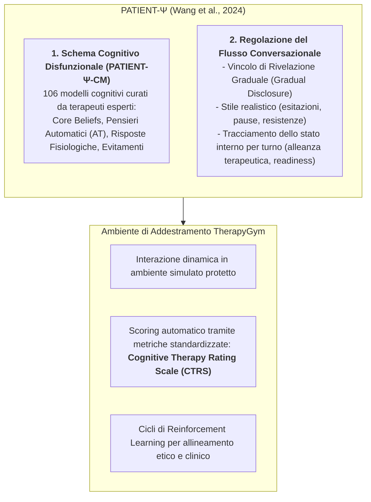

# Analisi dei Framework di Prompting Strutturato in Ambito Clinico e Sanitario

**Summary**: Documento di analisi sistematica e rassegna metodologica sullo stato dell'arte del prompt engineering e dei framework di inferenza strutturata applicati alla medicina, alla documentazione clinica (EHR/SOAP) e alla psicoterapia generativa. Il testo approfondisce lo standard internazionale di rendicontazione **[[tripod-llm-reporting-guideline|TRIPOD-LLM]]** (estensione 2025 di TRIPOD+AI), dimostra empiricamente il **[[clinical-chain-of-thought-paradox|paradosso del Chain-of-Thought (CoT) clinico]]** (degradamento delle prestazioni nell'86.3% dei modelli su cartelle elettroniche reali a causa dell'accumulo di errori non vincolati), esamina le architetture terapeutiche basate su partizione System/User e pacing (**[[coast-framework-clinical-prompting|COAST]]**), delinea i meccanismi neurali e le strategie di mitigazione dei bias demografici nei layer MLP intermedi (**Exploratory Thinking**, deliberazione **Multi-Agente**) e presenta i paradigmi di simulazione avanzata del paziente (**[[patient-psi-simulazione-clinica|PATIENT-Ψ]]**, **TherapyGym**).

**Fonti**: Rassegna metodologica e tavola sinottica della letteratura clinico-computazionale 2024-2026.
**Last updated**: 2026-08-28

---

## Definizione Operativa e Inquadramento Generale

L'adozione dei [[large-language-models|Modelli Linguistici di Grandi Dimensioni (LLM)]] in medicina e psicoterapia ha evidenziato una transizione fondamentale: il passaggio da interazioni informali basate su prompt generici (*ad-hoc prompting*) a **framework ingegneristico-clinici formalizzati e verificabili**.

La specificità del dominio clinico — dominato da dati ad altissimo rumore, frammentazione lessicale, vincoli etico-deontologici stringenti e gravità delle conseguenze diagnostico-terapeutiche — rende inadeguati sia i benchmark tradizionali di elaborazione del linguaggio naturale (NLP) sia le euristiche di ragionamento non vincolate.

---

## Sezione 1: Il Framework TRIPOD-LLM e lo Stato dell'Arte delle Linee Guida

Formalizzato all'inizio del 2025 da **Gallifant et al.** come estensione specialistica della dichiarazione *TRIPOD+AI*, lo standard **[[tripod-llm-reporting-guideline|TRIPOD-LLM]]** (*Transparent Reporting of a multivariable model for individual prognosis or diagnosis - Large Language Models*) rappresenta la linea guida metodologica di riferimento per la pubblicazione e validazione scientifica di studi che integrano modelli linguistici generativi e strategie di prompt engineering in medicina.

### 1.1 I Requisiti di Rendicontazione Tecnica
1. **Dettaglio del Prompt Engineering (Item 6c):** Obbligo di pubblicare l'esatta sintassi dei prompt impiegati, compresi i messaggi di sistema (*system messages*), i template per l'utente, i vincoli di formattazione (es. schemi JSON) e i meccanismi adottati per preservare la stabilità dell'output.
2. **Parametri di Generazione e Inferenza (Item 6c):** Tracciamento sistematico delle variabili stocastiche: *random seed*, *temperatura*, *max token length*, penalità di frequenza e presenza (*frequency/presence penalties*) e metodo di decodifica (*greedy*, *nucleus sampling*, *top-k*). Per i modelli commerciali proprietari a codice chiuso interrogati via API, deve essere registrata la data esatta dell'esperimento per rilevare alterazioni prestazionali indotte da aggiornamenti silenti (*silent model updates*).
3. **Strategie di Allineamento e Ottimizzazione (Item 6b):** Esplicitazione delle tecniche di post-pretraining impiegate, quali *Supervised Fine-Tuning* (SFT), *Reinforcement Learning from Human Feedback* (RLHF) o *Direct Preference Optimization* (DPO), descrivendone i target di utilità, onestà e innocuità (*helpfulness, honesty, harmlessness*).
4. **Caratterizzazione Temporale e Valutazione Umana (Item 5c e 7d):** Dichiarazione dell'intervallo temporale delle fonti (data del reperto più antico e più recente nel dataset clinico) e rendicontazione puntuale delle qualifiche professionali, del background e del training dei valutatori clinici umani coinvolti negli audit qualitativi.
5. **Posizionamento Clinico e Autonomia Operativa (Item 3b e 19d):** Definizione accurata della popolazione target, della collocazione del modello nel percorso di cura (*care pathway*) e del grado di autonomia decisionale concesso al sistema, specificando le modalità di supervisione umana (*human-in-the-loop*).

### 1.2 Limiti delle Metriche Tradizionali ed Ecosistema delle Linee Guida
Le riviste biomediche di vertice impongono TRIPOD-LLM poiché le metriche classiche di sovrapposizione lessicale superficiale (come **BLEU** o **ROUGE**) sono clinicamente cieche: non discriminano tra una parafrasi corretta e un errore nosografico letale.

L'ecosistema di reporting comprende standard complementari:
- **REFINE** (*Reporting checklist for FoundatIon and large laNguagE models*): orientato alla trasparenza dei modelli di fondazione biomedici generali;
- **FLAIR** (*Framework for LLM Assessment in Radiology*): 32 item distribuiti in 6 categorie per la trasparenza dei dati e l'integrazione di flussi multimodali in radiologia;
- **[[chart-reporting-guideline|CHART]]** (*Chatbot Assessment Reporting Tool*): focalizzato su chatbot di consulenza sanitaria;
- **[[elevate-genai-framework|ELEVATE-GenAI]]**: specifico per la ricerca economico-sanitaria e gli esiti clinici (HEOR).

---

## Sezione 2: Controllo dei Livelli di Astrazione e il Paradosso del Chain-of-Thought Clinico

Il controllo dell'astrazione semantica è l'elemento determinante per evitare allucinazioni e derive diagnostiche. Nelle discipline formali (matematica, logica simbolica), le catene di pensiero (*Chain-of-Thought* - CoT) potenziano il ragionamento; tuttavia, nei testi clinici reali si assiste a una clamorosa inversione empirica nota come **[[clinical-chain-of-thought-paradox|paradosso del CoT clinico]]**.

### 2.1 Evidenze Empiriche: Wu et al. (2025) e Note SOAP
- **La Valutazione su 95 Modelli ed 87 Task Clinici:** La sperimentazione sistematica di Wu et al. (2025) ha dimostrato che forzare i modelli a produrre passaggi deduttivi intermedi su testi derivati da cartelle cliniche elettroniche (EHR) genera un effetto a valanga (*avalanche effect*) in cui ogni piccolo errore inferenziale iniziale viene amplificato nei token successivi.
- **Penalizzazione nei Modelli di Frontiera per Note SOAP:** Studi recenti sulla redazione automatica di note cliniche SOAP (*Subjective, Objective, Assessment, Plan*) a partire da trascrizioni di colloqui reali hanno dimostrato che l'attivazione del canale di ragionamento avanzato (modelli tipo **o1** o **GPT-5.4**) peggiora la qualità finale del documento, introducendo deduzioni plausibili ma del tutto inventate o non supportate dal colloquio, con gravi rischi per la sicurezza dei pazienti.

### 2.2 Framework di Prompting Strutturato e Architettura LLM4CBT
Per contrastare il degradamento del CoT, la ricerca clinica adotta framework di confinamento rigoroso:

1. **Framework [[coast-framework-clinical-prompting|COAST]] (Context, Objective, Actions, Scenario, Task):** Isola nettamente i dati oggettivi del paziente (*Context, Scenario*) dalla procedura di elaborazione (*Actions, Task*), forzando il modello a legare ogni deduzione a un'evidenza testuale esplicita.
2. **Architettura [[LLM4CBT]] (Kim et al., 2025):** Compartimenta rigidamente il prompt di sistema (che definisce le basi teoriche della CBT, i pensieri automatici e la tecnica della freccia discendente) e il prompt utente (che introduce regole attive di pacing conversazionale, obbligando il sistema a riflettere e normalizzare senza proporre soluzioni affrettate).

---

## Sezione 3: Simulazione del Paziente, Interazione Relazionale e Gestione dei Bias

L'impiego degli LLM per generare vignette cliniche e simulare colloqui terapeutici presenta vulnerabilità critiche legate alla propagazione di bias demografici e cognitivi.

### 3.1 Meccanismi Neurali e Tipologie di Bias nei Modelli Linguistici
Analisi di **interpretabilità meccanicistica** sui principali modelli open-weight (Zack et al., 2024; Ahsan et al., 2025) dimostrano che le informazioni demografiche (genere, etnia) sono fortemente localizzate all'interno dei moduli **Multilayer Perceptron (MLP)** nei livelli intermedi: specificamente il **layer 4** e l'intervallo tra i **layer 18 e 20**.

| Categoria di Bias | Manifestazione Clinica Osservata | Evidenza Empirica / Studio |
| :--- | :--- | :--- |
| **Amplificazione Epidemiologica** | Sovrarappresentazione patologia-genere molto superiore alla realtà. | GPT-4 attribuisce genere femminile nel **97%** delle vignette per artrite reumatoide (prevalenza reale: ~66%). Epatite B associata quasi solo ad asiatici; sarcoidosi a neri (Zack et al., 2024). |
| **Default Androcentrico** | Generazione automatica di pazienti maschi in assenza di genere esplicito nel prompt. | Il modello assegna il maschile nel **75%–94%** dei casi neutri; il femminile compare solo in contesti stereotipati (Sant et al., 2024). |
| **Disparità Allocativa Terapeutica** | Differenziazione ingiustificata dei percorsi di cura a parità di sintomi acuti. | Di fronte a dolore toracico identico, i modelli propongono ospedalizzazione ed ECG per i maschi, terapia palliativa o analgesici domiciliari per le femmine (Zack et al., 2024). |
| **Discriminazione Minoranze Sessuali** | Giudizi moralizzanti o allucinazioni cliniche su persone LGBTQIA+. | Inappropriatezza etico-clinica nel **43%–62%** delle interazioni con profili LGBTQIA+ (PMC12416741). |

### 3.2 Simulazione Avanzata di Pazienti: Framework PATIENT-Ψ e TherapyGym
Nella formazione clinica, l'uso di prompt ingenui che chiedono al modello di "recitare un paziente con depressione" genera simulazioni stereotipate, piatte e irrealisticamente cooperative (*sycophancy* indotta da RLHF).

- **PATIENT-Ψ e il Dataset PATIENT-Ψ-CM:** Integra 106 schemi cognitivi CBT profondi, ancorando le reazioni dell'agente a schemi nucleari e credenze condizionali realistiche anziché a meri elenchi sintomatici DSM.
- **Gradual Disclosure (Rivelazione Graduale):** Il prompt di sistema inibisce la confessione immediata del quadro patologico, vincolando l'emersione di vissuti intimi o traumatici allo sviluppo di un'autentica alleanza terapeutica nel corso di più turni.
- **TherapyGym:** Ambiente di simulazione interattivo che traduce scale cliniche standardizzate come la *Cognitive Therapy Rating Scale* (CTRS) in funzioni di ricompensa per il fine-tuning e l'allineamento dei modelli terapeutici.

---

## Sezione 4: Tavola Sinottica dei Paper Chiave

| Autore / Anno | Framework di Prompting / Metodologia | Ambito Clinico / Applicativo | Risultato / Evidenza Principale |
| :--- | :--- | :--- | :--- |
| **Gallifant et al. (2025)** | Linee guida e checklist standardizzata **[[tripod-llm-reporting-guideline\|TRIPOD-LLM]]** | Metodologia di reporting, trasparenza e riproducibilità nella ricerca medica con LLM | Formulazione del protocollo a 19 macro-item e 50 sotto-item per la rendicontazione dei parametri stocastici, del prompt engineering e dell'allineamento. |
| **Wu et al. (2025)** | Catene Logiche Sequenziali (CoT) vs. Prompting Diretto Zero-Shot | Comprensione di testi clinici complessi ed estrazione da cartelle elettroniche (EHR) | **Degradamento prestazionale nell'86.3% di 95 modelli** a causa dell'accumulo di errori (allucinazioni, omissioni, incompletezza) lungo CoT non vincolati. |
| **Wang et al. (2024)** | Architettura di simulazione psicologica **[[patient-psi-simulazione-clinica\|PATIENT-Ψ]]** | Training specialistico di psicoterapeuti nella concettualizzazione del caso CBT | Rilascio del dataset *PATIENT-Ψ-CM* (106 schemi cognitivi); fedeltà clinica significativamente superiore a GPT-4 standard ed eliminazione della compiacenza artificiale. |
| **Kim et al. (2025)** | Architettura **[[LLM4CBT]]** con partizione System/User e controllo del pacing | Elicitazione di pensieri automatici (AT) in interventi CBT digitali | Ottimizzazione dell'alleanza tramite risposte riflessive ed empatiche, inibizione di consigli precoci e regolazione del ritmo sul livello di engagement del paziente. |
| **Sant et al. (2024)** | Prompting Few-Shot, Context-Supplying e vincoli demografici | Traduzione medica specialistica e mitigazione del bias di genere | Riduzione delle risposte polarizzate al maschile fino al **12%** sul benchmark WinoMT rispetto a configurazioni di prompt lineari. |
| **Wei et al. (2025)** | Prompting di Pensiero Esplorativo (*Exploratory Thinking*) a due stadi | Mitigazione del bias di genere nella valutazione clinica e decision-making etico | Correzione automatica delle asimmetrie decisionali attraverso la generazione e il confronto critico di casi paralleli con swap demografico. |
| **Zack et al. (2024)** | Ingegneria dei prompt demografici e analisi di interpretabilità meccanicistica | Generazione di vignette cliniche e analisi epidemiologica delle risposte | Dimostrazione dell'esagerazione stereotipica (97% artrite reumatoide femminile vs 66% reale) e localizzazione dei bias nei moduli MLP intermedi (layer 4, 18-20). |
| **Ke et al. (2024)** | Framework collaborativo multi-agente con ruoli cognitivi differenziati | Correzione dei bias cognitivi clinici (ancoraggio, conferma, chiusura precoce) | **Aumento dell'accuratezza diagnostica dal 0% al 76%** in casi complessi grazie alla dialettica simulata tra agenti specialistici e avvocato del diavolo. |

---

## Sezione 5: Conclusioni e Raccomandazioni Clinico-Tecnologiche

1. **Adozione Sistematica dello Standard TRIPOD-LLM:** Qualsiasi progetto biomedico o clinico basato su LLM deve documentare rigorosamente l'architettura dei prompt, i parametri stocastici (seed, temperatura, penalità) e le qualifiche dei valutatori umani.
2. **Contenimento delle Catene Logiche Non Vincolate (CoT) sui Testi Clinici:** Evitare CoT liberi su testi complessi o EHR frammentati; adottare scaffold rigidi come [[coast-framework-clinical-prompting|COAST]] o GOLD per separare i dati oggettivi dalle deduzioni.
3. **Programmazione Cognitiva dei Simulatori di Pazienti:** Superare i prompt basati su stereotipi o "personaggi" generici adottando schemi cognitivi formalizzati (PATIENT-Ψ-CM), regole di gradual disclosure e stili conversazionali ecologici.
4. **Regole di Pacing ed Elicitazione in Psicoterapia:** Inserire direttive comportamentali stringenti per forzare la riflessione e la normalizzazione, inibendo il problem-solving precoce dei modelli commerciali (LLM4CBT).
5. **Mitigazione Proattiva dei Bias Demografici e Clinici:** Implementare routine di *Exploratory Thinking* con swap demografico o architetture collaborative multi-agente per contrastare le distorsioni localizzate nei moduli MLP dei modelli.
6. **Integrazione di Ambienti di Addestramento e Scoring Standardizzati:** Utilizzare piattaforme come TherapyGym con metriche cliniche validate (es. *Cognitive Therapy Rating Scale* - CTRS) per guidare l'ottimizzazione e l'allineamento etico tramite Reinforcement Learning.

---

## Bibliografia Completa

Elenco delle fonti web consultate dalla rassegna, nell'ordine della fonte. Autori e anni sono indicati solo dove verificati; per le altre voci la fonte riporta solo titolo e URL.

1. Gallifant, J., Afshar, M., Ameen, S., Aphinyanaphongs, Y., Chen, S., Cacciamani, G., Demner-Fushman, D., Dligach, D., Daneshjou, R., Fernandes, C., Hansen, L. H., Landman, A., Lehmann, L., McCoy, L. G., Miller, T., Moreno, A., Munch, N., Restrepo, D., Savova, G., Umeton, R., Gichoya, J. W., Collins, G. S., Moons, K. G. M., Celi, L. A., & Bitterman, D. S. (2025). The TRIPOD-LLM reporting guideline for studies using large language models. *Nature Medicine*, 31(1), 60–69. https://doi.org/10.1038/s41591-024-03425-5
2. Altra versione dello studio al punto 1: The TRIPOD-LLM Reporting Guideline for Studies Using Large Language Models - DigitalCommons@TMC. https://digitalcommons.library.tmc.edu/cgi/viewcontent.cgi?article=5712&context=uthgsbs_docs (consultato il 5 giugno 2026).
3. Altra versione dello studio al punto 1: The TRIPOD-LLM Statement: A Targeted Guideline For Reporting Large Language Models Use | medRxiv. https://www.medrxiv.org/content/10.1101/2024.07.24.24310930v1.full-text (consultato il 5 giugno 2026).
4. Altra versione dello studio al punto 1: A Targeted Guideline For Reporting Large Language Models Use - The TRIPOD-LLM Statement. https://www.tripod-statement.org/wp-content/uploads/2025/01/TRIPOD-LLM-Filled-in-Example.pdf (consultato il 5 giugno 2026).
5. Kim, Y., Choi, C.-H., Cho, S., Sohn, J.-Y., & Kim, B.-H. (2025). Aligning large language models for cognitive behavioral therapy: A proof-of-concept study. *Frontiers in Psychiatry*, *16*, 1583739. https://doi.org/10.3389/fpsyt.2025.1583739
6. Guidelines for Reporting Studies on Large Language Models in Radiology: An International Delphi Expert Survey - RSNA Journals. https://pubs.rsna.org/doi/10.1148/radiol.250913 (consultato il 5 giugno 2026).
7. When Reasoning Hurts: Source-Aware Evaluation of Frontier LLMs for Clinical SOAP Note Generation - arXiv. https://arxiv.org/html/2605.24902v1 (consultato il 5 giugno 2026).
8. Mese, I., Akinci D’Antonoli, T., Bluethgen, C., Bressem, K., Cuocolo, R., Chaudhari, A., Tejani, A. S., Isaac, A., Ponsiglione, A., Meddeb, A., Khosravi, B., Le Guellec, B., Kahn, C. E., Jr., Suh, C. H., Pinto dos Santos, D., Koh, D.-M., Tzanis, E., Kotter, E., Colak, E., . . . Kocak, B. (2026). Reporting checklist for foundation and large language models in medical research (REFINE): An international consensus guideline. *Diagnostic and Interventional Radiology*. Advance online publication. https://doi.org/10.4274/dir.2026.263812
9. Altra versione dello studio al punto 5: Aligning large language models for cognitive behavioral therapy: a proof-of-concept study. https://pmc.ncbi.nlm.nih.gov/articles/PMC12446991/ (consultato il 5 giugno 2026).
10. What is chain of thought (CoT) prompting? - IBM. https://www.ibm.com/think/topics/chain-of-thoughts (consultato il 5 giugno 2026).
11. What Is Chain-of-Thought Prompting? - AWS. https://aws.amazon.com/what-is/chain-of-thought-prompting/ (consultato il 5 giugno 2026).
12. Chain of Thought Prompting Guide - PromptHub. https://www.prompthub.us/blog/chain-of-thought-prompting-guide (consultato il 5 giugno 2026).
13. Why Chain of Thought Fails in Clinical Text Understanding - arXiv. https://arxiv.org/html/2509.21933v1 (consultato il 5 giugno 2026).
14. [2509.21933] Why Chain of Thought Fails in Clinical Text Understanding - arXiv. https://arxiv.org/abs/2509.21933 (consultato il 5 giugno 2026).
15. Medical Chain-of-Thought Reasoning - Emergent Mind. https://www.emergentmind.com/topics/medical-chain-of-thought-reasoning (consultato il 5 giugno 2026).
16. Why Chain of Thought Fails in Clinical Text Understanding - OpenReview. https://openreview.net/pdf/4900a3adcdda607c62c216a28c8c6bfcbdc76fcd.pdf (consultato il 5 giugno 2026).
17. One Panel Does Not Fit All: Case-Adaptive Multi-Agent Deliberation for Clinical Prediction. https://arxiv.org/html/2604.00085v1 (consultato il 5 giugno 2026).
18. COAST framework - Navigating AI prompt engineering - Juuzt AI. https://juuzt.ai/knowledge-base/prompt-frameworks/the-coast-framework/ (consultato il 5 giugno 2026).
19. COAST Framework: Context, Objective, Actions, Scenario, Task – Fabio Vivas - fvivas.com. https://fvivas.com/en/coast-framework-prompts-llm/ (consultato il 5 giugno 2026).
20. Chatbots and prompt engineering - Pharmavibes. https://www.pharmavibes.co.uk/2024/11/20/chatbots-and-prompt-engineering/ (consultato il 5 giugno 2026).
21. Clinical Reasoning Skills - WebPath. https://webpath.med.utah.edu/TUTORIAL/REASON/REASON04.html (consultato il 5 giugno 2026).
22. A Reflective Verbalization Strategy to Trigger Alternative Diagnostic Hypotheses - PMC. https://pmc.ncbi.nlm.nih.gov/articles/PMC12415801/ (consultato il 5 giugno 2026).
23. Principles of diagnostic reasoning - The Pharmaceutical Journal. https://pharmaceutical-journal.com/article/ld/principles-of-diagnostic-reasoning (consultato il 5 giugno 2026).
24. Sant, A., Escolano, C., Mash, A., De Luca Fornaciari, F., & Melero, M. (2024). The power of prompts: Evaluating and mitigating gender bias in MT with LLMs. In *Proceedings of the 5th Workshop on Gender Bias in Natural Language Processing (GeBNLP)* (pp. 94–139). Association for Computational Linguistics. https://doi.org/10.18653/v1/2024.gebnlp-1.7
25. Evaluating anti-LGBTQIA+ medical bias in large language models - PMC. https://pmc.ncbi.nlm.nih.gov/articles/PMC12416741/ (consultato il 5 giugno 2026).
26. Evaluating gender bias in large language models in long-term care - PMC. https://pmc.ncbi.nlm.nih.gov/articles/PMC12337462/ (consultato il 5 giugno 2026).
27. Gender Bias in Large Language Models for Healthcare: Assignment Consistency and Clinical Implications - arXiv. https://arxiv.org/pdf/2510.08614 (consultato il 5 giugno 2026).
28. Ahsan, H., Sen Sharma, A., Amir, S., Bau, D., & Wallace, B. C. (2025). Elucidating mechanisms of demographic bias in LLMs for healthcare. In *Findings of the Association for Computational Linguistics: EMNLP 2025* (pp. 14614–14631). Association for Computational Linguistics. https://aclanthology.org/2025.findings-emnlp.789
29. Altra versione dello studio al punto 28: Elucidating Mechanisms of Demographic Bias in LLMs for Healthcare - ACL Anthology. https://aclanthology.org/2025.findings-emnlp.789.pdf (consultato il 5 giugno 2026).
30. Altra versione dello studio al punto 24: The power of Prompts: Evaluating and Mitigating Gender Bias in MT with LLMs. https://aclanthology.org/2024.gebnlp-1.7/ (consultato il 5 giugno 2026).
31. Wei, K., Abdullah, H. M., & Huang, R. (2025). Mitigating gender bias via fostering exploratory thinking in LLMs. In *Findings of the Association for Computational Linguistics: EMNLP 2025* (pp. 6895–6917). Association for Computational Linguistics. https://doi.org/10.18653/v1/2025.findings-emnlp.364
32. Ke, Y., Yang, R., Lie, S. A., et al. (2024). Mitigating cognitive biases in clinical decision-making through multi-agent conversations using large language models: Simulation study. *Journal of Medical Internet Research*, *26*, e59439. https://doi.org/10.2196/59439
33. PatientHub: A Unified Framework for Patient Simulation - arXiv. https://arxiv.org/pdf/2602.11684 (consultato il 5 giugno 2026).
34. Wang, R., Milani, S., Chiu, J. C., et al. (2024). PATIENT-Ψ: Using large language models to simulate patients for training mental health professionals. In *Proceedings of the 2024 Conference on Empirical Methods in Natural Language Processing*. Association for Computational Linguistics. https://doi.org/10.48550/arXiv.2405.19660
35. Altra versione dello studio al punto 34: Patient-Ψ: Using Large Language Models to Simulate Patients for Training Mental Health Professionals - arXiv. https://arxiv.org/html/2405.19660v3 (consultato il 5 giugno 2026).
36. Altra versione dello studio al punto 34: PATIENT-Ψ: Using Large Language Models to Simulate Patients for Training Mental Health Professionals - ACL Anthology. https://aclanthology.org/2024.emnlp-main.711.pdf (consultato il 5 giugno 2026).
37. Altra versione dello studio al punto 34: Using Large Language Models to Simulate Patients for Training Mental Health Professionals - arXiv. https://arxiv.org/html/2405.19660v2 (consultato il 5 giugno 2026).
38. Can Large Language Models Simulate Patients with Mental Health Conditions? Meet Patient-Ψ: A Novel Patient Simulation Framework for Cognitive Behavior Therapy (CBT) Training - MarkTechPost. https://www.marktechpost.com/2024/07/01/can-large-language-models-simulate-patients-with-mental-health-conditions-meet-patient-%CF%88-a-novel-patient-simulation-framework-for-cognitive-behavior-therapy-cbt-training/ (consultato il 5 giugno 2026).
39. TherapyGym: Evaluating and Aligning Clinical Fidelity and Safety in .... https://openreview.net/forum?id=nwANzdlMKI (consultato il 5 giugno 2026).
40. Altra versione dello studio al punto 34: PATIENT-𝜓: Using Large Language Models to Simulate Patients for Training Mental Health Professionals | Request PDF - ResearchGate. https://www.researchgate.net/publication/386203094_PATIENT-_Using_Large_Language_Models_to_Simulate_Patients_for_Training_Mental_Health_Professionals (consultato il 5 giugno 2026).
41. Bias Patterns in the Application of LLMs for Clinical Decision Support - PMC - NIH. https://pmc.ncbi.nlm.nih.gov/articles/PMC13048765/ (consultato il 5 giugno 2026).
42. Prompt Engineering Frameworks: A Comparative Research Overview of RACE, CARE, APE, CREATE, TAG, CREO, RISE, PAIN, COAST, and ROSES - Medium. https://medium.com/@vamsiparasar1992/prompt-engineering-frameworks-a-comparative-research-overview-of-race-care-ape-create-tag-354082db86b3 (consultato il 5 giugno 2026).
43. AI Prompt Frameworks | West Virginia School of Osteopathic Medicine. https://www.wvsom.edu/ai/prompt-frameworks (consultato il 5 giugno 2026).
44. Synthetic or Authentic? Building Mental Patient Simulators from Longitudinal Evidence - arXiv. https://arxiv.org/pdf/2603.22704 (consultato il 5 giugno 2026).
45. Evaluating and Aligning Clinical Fidelity and Safety in Therapy Chatbots - TherapyGym. https://therapygym.stanford.edu/paper.pdf (consultato il 5 giugno 2026).

---

## Relazioni

- **Pagine di Concetto Correlate create da questa fonte:**
  - [[tripod-llm-reporting-guideline]]: Guida approfondita allo standard internazionale di reporting TRIPOD-LLM (2025), checklist a 19 macro-item e parametri operativi.
  - [[clinical-chain-of-thought-paradox]]: Analisi del paradosso CoT nei testi clinici reali (EHR), tassonomia degli errori (allucinazione, omissione, incompletezza) e soluzioni di scaffolding.
- **Pagine della Wiki collegate:**
  - [[chart-reporting-guideline]]: Standard di reporting EQUATOR per chatbot di salute.
  - [[elevate-genai-framework]]: Standard di reporting per HEOR e simulazioni economico-sanitarie.
  - [[gamer-reporting-guideline]]: Linee guida per l'uso dell'IA nella ricerca accademica.
  - [[coast-framework-clinical-prompting]]: Framework pentapartito per il prompting clinico a livelli di astrazione.
  - [[patient-psi-simulazione-clinica]]: Architettura di simulazione paziente CBT e meccanismo di gradual disclosure.
  - [[clinical-ai-blueprint]]: Inquadramento generale della GenAI in psicoterapia e medicina.
  - [[audit-bias-llm-clinici]]: Audit e mitigazione dei bias algoritmici.
  - [[stepwise-cot]]: Scomposizione del ragionamento per stadi sequenziali.
  - [[accuratezza-vs-fattualita-in-genai]]: Distinzione critica tra plausibilità formale e veridicità clinica.
  - [[prompt-experiment-gap-in-clinical-ai]]: Divario tra sperimentazioni in vitro su prompt sintetici e pratica clinica ecologica.

## Riferimenti Bibliografici
- Ahsan, H., Sen Sharma, A., Amir, S., Bau, D., & Wallace, B. C. (2025). Elucidating mechanisms of demographic bias in LLMs for healthcare. In *Findings of the Association for Computational Linguistics: EMNLP 2025* (pp. 14614–14631). Association for Computational Linguistics. https://aclanthology.org/2025.findings-emnlp.789
- Ke, Y., Yang, R., Lie, S. A., et al. (2024). Mitigating cognitive biases in clinical decision-making through multi-agent conversations using large language models: Simulation study. *Journal of Medical Internet Research*, *26*, e59439. https://doi.org/10.2196/59439
- Gallifant, J., Afshar, M., Ameen, S., Aphinyanaphongs, Y., Chen, S., Cacciamani, G., Demner-Fushman, D., Dligach, D., Daneshjou, R., Fernandes, C., Hansen, L. H., Landman, A., Lehmann, L., McCoy, L. G., Miller, T., Moreno, A., Munch, N., Restrepo, D., Savova, G., Umeton, R., Gichoya, J. W., Collins, G. S., Moons, K. G. M., Celi, L. A., & Bitterman, D. S. (2025). The TRIPOD-LLM reporting guideline for studies using large language models. *Nature Medicine*, 31(1), 60–69. https://doi.org/10.1038/s41591-024-03425-5
- Kim, Y., Choi, C.-H., Cho, S., Sohn, J.-Y., & Kim, B.-H. (2025). Aligning large language models for cognitive behavioral therapy: A proof-of-concept study. *Frontiers in Psychiatry*, *16*, 1583739. https://doi.org/10.3389/fpsyt.2025.1583739
- Sant, A., Escolano, C., Mash, A., De Luca Fornaciari, F., & Melero, M. (2024). The power of prompts: Evaluating and mitigating gender bias in MT with LLMs. In *Proceedings of the 5th Workshop on Gender Bias in Natural Language Processing (GeBNLP)* (pp. 94–139). Association for Computational Linguistics. https://doi.org/10.18653/v1/2024.gebnlp-1.7
- Wang, R., Milani, S., Chiu, J. C., et al. (2024). PATIENT-Ψ: Using large language models to simulate patients for training mental health professionals. In *Proceedings of the 2024 Conference on Empirical Methods in Natural Language Processing*. Association for Computational Linguistics. https://doi.org/10.48550/arXiv.2405.19660
- Wei, K., Abdullah, H. M., & Huang, R. (2025). Mitigating gender bias via fostering exploratory thinking in LLMs. In *Findings of the Association for Computational Linguistics: EMNLP 2025* (pp. 6895–6917). Association for Computational Linguistics. https://doi.org/10.18653/v1/2025.findings-emnlp.364
- Wu, J., Xie, K., Gu, B., Krüger, N., Lin, K. J., & Yang, J. (2025). *Why chain of thought fails in clinical text understanding* (arXiv:2509.21933). arXiv. https://doi.org/10.48550/arXiv.2509.21933
- Zack, T., et al. (2024). Assessing the potential of GPT-4 to perpetuate racial and gender biases in health care: A model evaluation study. *The Lancet Digital Health*, *6*, e12–e22.
